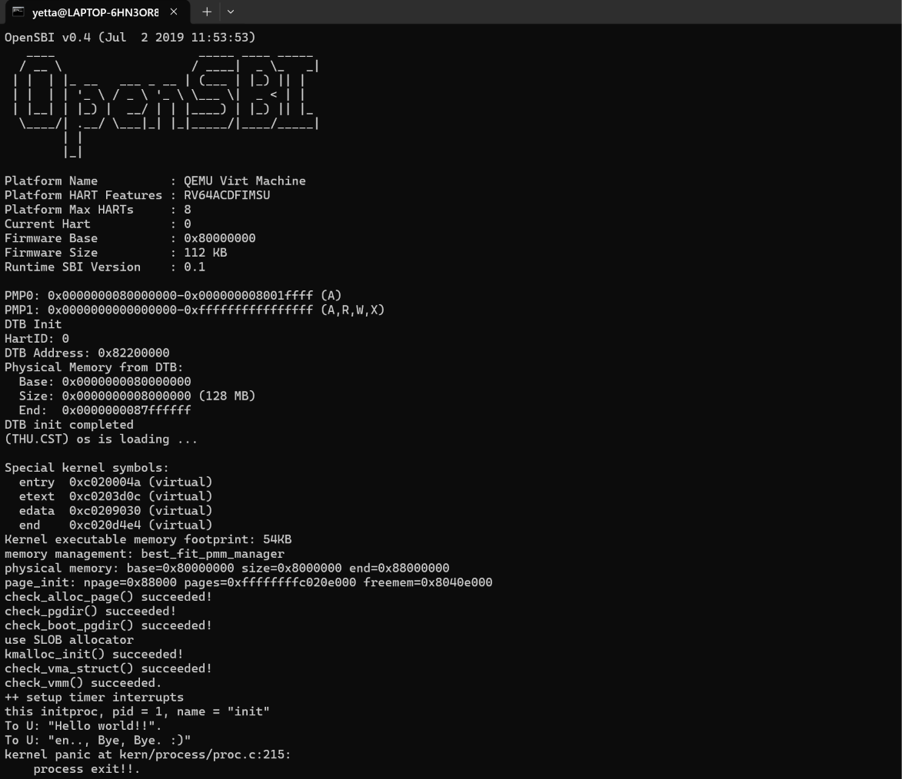
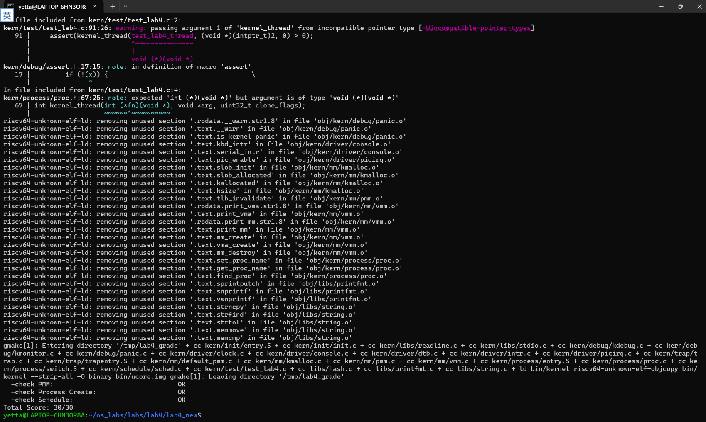

# 实验报告
## 实验基本信息

| 项目 | 内容 |
|------|------|
| **实验名称** | Lab 4: 进程管理 |
| **小组成员** | 2513907-薛欣宜、2513447 黄天怡、2510943-张艺涵 |
| **完成日期** | 2026-11-20 |

### 小组分工

| 成员 | 负责的练习/模块 |
|------|----------------|
| 2513907-薛欣宜 | 功能模块一：虚拟内存页操作功能 |
| 2513447 黄天怡 | 功能模块二：进程创建及初始化功能 |
| 2510943-张艺涵 | 功能模块三：进程调度、Challenge 1 |

**实验报告由三个成员分别撰写各自负责的部分，最后由组长完成汇总。**

---

## 一、实验目的

<!-- 说明本次实验的主要目标和预期成果 -->

本实验的主要目的是：

1. 了解虚拟内存管理的基本结构，掌握虚拟内存的组织与管理方式
2. 了解内核线程创建/执行的管理过程
3. 了解内核线程的切换和基本调度过程

---

## 二、实验环境

实验采用 RISC-V 64 位架构，在 QEMU Virt Machine 中运行，使用 `riscv64-unknown-elf` 工具链编译。

本实验使用的 AI 工具如下：

| 成员 | AI 编程工具 | 底层模型 | 备注 |
|------|------------|---------|------|
| 2513907-薛欣宜 | Codex | GPT-6 Sol | 无 |
| 2513447 黄天怡 | Codex | GPT-6 Sol | 无 |
| 2510943-张艺涵 | Claude Code（终端 Agent）|  DeepSeek-V4-Flash | 无 |


---

## 三、实验整体逻辑分析

### 3.1 本章节的逻辑主线

本实验依托 Lab2/3 已有的物理内存管理、基础页表和中断异常处理能力，按照“虚拟内存页操作 → 进程创建与初始化 → 进程调度”三条主线展开，使内核能够创建线程、登记线程，并通过调度和上下文切换让线程真正运行起来。当前实验主要管理共享内核地址空间的内核线程。

整体流程是先完成内存、中断和虚拟内存等基础初始化，再通过 `proc_init()` 建立进程管理结构并创建线程，随后进入调度与切换流程：

```text
proc_init() → cpu_idle() → schedule() → proc_run() → switch_to()
```

前期初始化为线程准备资源和执行环境，后续调度选择可运行线程，并恢复其执行现场，使 CPU 转入目标线程。

### 3.2 功能的逐步实现

1. **完善虚拟内存页操作。** 实现 `page_insert()` 和 `page_remove()`，完成页映射的建立、更新和撤销，同时维护物理页引用计数并使对应 TLB 缓存失效。这一部分完善底层内存管理，为后续线程资源管理提供基础。
2. **实现进程创建与初始化。** 通过 `alloc_proc()` 初始化 PCB，使用 `proc_init()` 建立进程链表、哈希表和 `idleproc`，再由 `kernel_thread()`、`do_fork()` 创建 `initproc`。`copy_mm()` 设置共享内核地址空间，`copy_thread()` 准备内核栈、TrapFrame 和 context，使新线程具备首次运行的条件。
3. **实现进程调度与上下文切换。** 在已有线程及其执行现场的基础上，由 `cpu_idle()` 检查调度需求，`schedule()` 按链表顺序选择可运行线程，`proc_run()` 更新当前进程并设置页表，`switch_to()` 保存和恢复寄存器上下文。新线程首次运行时经 `forkret` 等恢复代码进入线程入口，完成从创建到执行的衔接。

这一顺序体现了各模块的依赖关系：先完善内存管理，再准备线程资源和执行现场，最后通过调度与切换实现多个内核线程共享 CPU。

---

## 四、实验内容与实现

<!-- 
说明：本部分按照 exercises 文档中的练习顺序组织
每个功能模块或者练习中可能包含多项任务，请根据实际情况调整
-->
### 功能模块一：虚拟内存页操作功能

**负责人：** 2513907-薛欣宜

#### 模块功能描述

**需要实现或修改的函数：**

`kern/mm/pmm.c`

```c
int page_insert(pde_t *pgdir, struct Page *page, uintptr_t la, uint32_t perm);
void page_remove(pde_t *pgdir, uintptr_t la);
```

**功能说明：**

- **建立或更新映射**。`page_insert()` 调用 `get_pte()` 获取目标线性地址对应的页表项，必要时创建页表。根据目标物理页的页号和 `perm` 构造新页表项，建立映射或更新权限。获取页表项失败时返回 `-E_NO_MEM`，成功时返回 `0`。
- **维护引用计数**。原地址未映射或映射到其他物理页时，增加目标页的引用计数；原地址已映射到同一物理页时，引用计数保持不变。替换旧映射后，减少旧页的引用计数，归零时释放旧页。
- **安全撤销映射**。`page_remove()` 查找已有页表项，不创建页表。目标地址未映射时直接返回；存在映射时清空页表项，减少对应物理页的引用计数，归零时释放。
- **同步 TLB**。建立、更新或撤销映射后，调用 `tlb_invalidate()` 使目标地址对应的 TLB 缓存失效，保证后续访问使用更新后的映射和权限。

实现时沿用原有函数签名和页表管理接口，修改范围限于标记位置的 `page_insert()` 与 `page_remove()`，保留其他代码。

#### 最终提示词

以下是经过迭代优化后，最终成功实现该功能的提示词：

````text

[prompt]
**任务**
补全 `kern/mm/pmm.c` 中空缺的两个函数：
1. `int page_insert(pde_t *pgdir, struct Page *page, uintptr_t la, uint32_t perm);`
2. `void page_remove(pde_t *pgdir, uintptr_t la);`

分别实现：将物理页映射到指定线性地址、安全撤销已有映射。

**操作要求**
直接修改项目中的实际文件，保留现有代码，只在标记位置补全，不修改其他函数。

**输出要求**
完成文件修改后，简要说明实现要点和验证结果；未运行的测试须明确标注。

[RELY]
- 复用已有接口：`get_pte()`、`pte_create()`、`page2ppn()`、`pte2page()`、`page_ref_inc()`、`page_ref_dec()`、`free_page()`、`tlb_invalidate()` 等。
- 使用现有类型和宏：`pde_t`、`pte_t`、`struct Page`、`PTE_V`、`PTE_U`、`PTE_W`、`PTE_R`。
- 先阅读相关接口定义，确认参数和返回值含义。

[GUARANTEE]
- `page_insert`：
  1. 原地址未映射：目标页引用计数加一。
  2. 原地址映射到同一物理页：引用计数不变，仅更新权限，避免误释放。
  3. 原地址映射到其他物理页：目标页引用计数加一；旧页引用计数减一，归零时释放。
  4. 成功后映射到目标页，权限按 `perm` 重新设置，不残留旧权限，返回 `0`。
  5. 获取页表项失败时返回 `-E_NO_MEM`，不改变目标页引用计数和已有映射。

- `page_remove`：
  1. 目标地址无映射时安静返回，不分配页表。
  2. 有映射时清空 PTE，使对应 TLB 条目失效；旧页引用计数减一，归零后释放。
  3. 返回类型为 `void`，无需返回错误码，也无需回收中间页表页。

[SPECIFICATION]
- 同步维护三个状态：PTE、物理页引用计数、TLB。
- 插入使用 `get_pte(pgdir, la, 1)`；删除使用 `get_pte(pgdir, la, 0)`。
- 使用 `pte_create()` 构造新 PTE，正确设置物理页号、有效位和权限。
- 映射或权限更新后，调用 `tlb_invalidate(pgdir, la)`。
- 重点检查：同页重复插入、替换旧页、多地址共享同一页、重复删除、页表分配失败。
````

#### 实现迭代过程

本模块通过细化提示词，明确已有接口和修改范围，重点约束同页重复插入、替换旧映射及重复删除等边界情况，保证页表项、引用计数和 TLB 同步维护。

**最终结果：**

- ✅ 完成 `page_insert()` 和 `page_remove()`，实现页映射的建立、更新与撤销。
- ✅ 测试截图显示页表自检通过，评分测试中 PMM 项为 `OK`。

---

### 功能模块二：进程创建及初始化功能

**负责人：** 2513447 黄天怡

#### 模块功能描述

**需要实现/修改的函数：**

```text
alloc_proc()：分配并初始化进程控制块 PCB。

proc_init()：初始化进程管理结构，并创建 idleproc 和 initproc。

kernel_thread()：将函数入口和参数封装为内核线程的初始执行现场。

do_fork()：分配线程资源、分配 PID、登记并唤醒线程。

copy_thread()：准备新线程的 TrapFrame 和上下文。

copy_mm()：完成当前实验中的内核地址空间初始化。

```


**功能说明：**

本模块主要实现 uCore 内核线程的创建与初始化功能，使系统能够从单一执行流发展为可以管理多个内核线程的操作系统。

具体包括三个部分：

- 进程控制块及系统初始化。 通过 alloc_proc() 分配并初始化 PCB，在 proc_init() 中建立进程链表、哈希表和空闲线程 idleproc，并创建第一个内核线程 initproc。

- 内核线程创建与资源管理。 通过 kernel_thread() 构造初始执行现场，再由 do_fork() 完成 PCB、内核栈、PID 等资源的分配与登记，并将新线程设置为可运行状态。

- 线程执行现场准备。 通过 copy_thread() 设置新线程的 TrapFrame 和 context，使线程能够在首次调度后进入 forkret，再恢复到预定的执行入口；copy_mm() 则负责当前阶段的共享内核地址空间设置。

#### 最终提示词

以下是经过迭代优化后，最终成功实现该功能的提示词：

````text
**任务：**

完成 Lab4 功能模块二：进程创建及初始化功能。

需要修改 `kern/process/proc.c`，实现以下六个函数：

```c
static struct proc_struct *alloc_proc(void);
void proc_init(void);
int kernel_thread(int (*fn)(void *), void *arg, uint32_t clone_flags);
int do_fork(uint32_t clone_flags, uintptr_t stack, struct trapframe *tf);
static void copy_thread(struct proc_struct *proc, uintptr_t esp, struct trapframe *tf);
static int copy_mm(uint32_t clone_flags, struct proc_struct *proc);
```

本模块主要完成进程控制块的分配与初始化、内核线程的创建、内核栈及执行上下文的准备，以及进程登记和唤醒，使系统能够创建 `idleproc` 和 `initproc`，为后续进程调度提供基础。

**操作要求：**

1. 直接修改项目中的实际文件，不要只给出代码。
2. 修改前阅读 `proc.c`、`proc.h`、`entry.S`、`trap.h`、`pmm.h`、`memlayout.h`、`sched.c`、`switch.S` 等相关文件。
3. 以当前项目实际代码为准，不要直接套用其他版本的 uCore。
4. 主要修改 `proc.c` 中标记为 `LAB4 function2 YOUR CODE` 的位置，必要时补充头文件和函数声明。
5. 保留已经实现的内存管理、Trap 处理和进程调度代码，不修改其他功能模块。

**[RELY]**

1. 当前项目使用 RISC-V 64 位架构，已经完成物理内存管理、Sv39 页表及基本 Trap 处理机制。

2. `proc.h` 中已经定义 `struct proc_struct`、`struct context` 和进程状态枚举，可直接使用。

3. `proc.c` 中已经提供 `setup_kstack()`、`put_kstack()`、`get_pid()`、`hash_proc()`、`find_proc()`、`forkret()`、`init_main()` 等辅助函数。

4. 已有 `kmalloc()`、`kfree()`、`alloc_pages()`、`free_pages()`、`list_init()`、`list_add()`、`wakeup_proc()` 等内存分配与进程管理接口。

5. `entry.S` 中的 `kernel_thread_entry` 使用 `s0` 保存线程执行函数地址，`s1` 保存函数参数。

6. 新线程首次运行依赖 `switch_to -> forkret -> forkrets -> __trapret`，其中 `forkret()` 已经实现。

7. 当前实验仅要求创建内核线程，所有内核线程共享内核地址空间，不需要复制独立的用户地址空间。

**[GUARANTEE]**

本次需要完成六个函数：

1. `alloc_proc()`：分配并初始化进程控制块。
2. `proc_init()`：初始化进程管理结构，创建 `idleproc` 和 `initproc`。
3. `kernel_thread()`：将普通函数和参数封装为内核线程的初始执行现场。
4. `do_fork()`：完成新线程的资源分配、PID 分配、登记与唤醒。
5. `copy_thread()`：复制 TrapFrame 并初始化新线程的上下文。
6. `copy_mm()`：处理内核线程共享地址空间的初始化。

不得修改已有的 `proc_run()`、`cpu_idle()`、`schedule()`、`switch_to()` 等模块三函数，也不要实现超出本次实验要求的用户进程功能。

**[SPECIFICATION]**

**1. alloc_proc**

Pre-Condition：

内核堆分配器已经初始化，可以通过 `kmalloc()` 分配进程控制块。

Post-Condition：

返回完成基础初始化的 `proc_struct`，分配失败返回 `NULL`。

具体要求：

- 分配 PCB 并清零所有字段。
- 设置初始状态为 `PROC_UNINIT`、PID 为 `-1`。
- 初始化内核栈、地址空间、上下文、TrapFrame、调度标记等字段。
- 初始化进程链表和哈希链表节点。
- 设置有效的内核页表地址。

**2. proc_init**

Pre-Condition：

进程管理所依赖的内存管理和相关基础设施已经初始化。

Post-Condition：

成功建立 `idleproc`、`initproc` 和 `current`，完成进程管理全局结构初始化。

具体要求：

- 初始化 `proc_list` 和 `hash_list`。
- 创建 `idleproc`，设置 PID 为 0、状态为 `PROC_RUNNABLE`。
- 复用启动内核栈 `bootstack`，设置 `current = idleproc`。
- 设置 `idleproc->need_resched = 1`。
- 调用 `kernel_thread()` 创建执行 `init_main()` 的 `initproc`。
- 使用 `find_proc()` 找到新线程，设置名称并检查 PID。
- 正确维护 `nr_process`。

**3. kernel_thread**

Pre-Condition：

提供有效的内核线程入口函数 `fn` 和参数 `arg`。

Post-Condition：

完成初始 TrapFrame 构造，并调用 `do_fork()` 返回新线程 PID 或负错误码。

具体要求：

- 清零临时 `trapframe`。
- 将 `fn` 和 `arg` 分别保存到 `s0`、`s1` 对应字段。
- 设置 `epc` 指向 `kernel_thread_entry`。
- 正确设置 `sstatus` 中的 SPP、SPIE 和 SIE 位。
- 调用 `do_fork()` 创建共享内核地址空间的线程。

**4. do_fork**

Pre-Condition：

提供合法的创建标志、栈地址和 TrapFrame，内存分配及进程管理接口可用。

Post-Condition：

创建成功返回 PID，失败返回负错误码并释放已经申请的资源。

具体要求：

- 检查进程数量上限。
- 调用 `alloc_proc()` 分配 PCB。
- 设置父进程，申请内核栈。
- 调用 `copy_mm()` 和 `copy_thread()`。
- 通过 `get_pid()` 分配 PID。
- 将线程加入进程链表和 PID 哈希表。
- 更新进程数量，并使用 `wakeup_proc()` 将线程设置为 `PROC_RUNNABLE`。
- 在必要的临界区内关闭中断。
- 正确处理资源分配失败时的清理流程。

**5. copy_thread**

Pre-Condition：

新线程已分配内核栈，且存在有效的初始 TrapFrame。

Post-Condition：

新线程具备首次上下文切换和执行所需的 TrapFrame、context。

具体要求：

- 在新内核栈顶部安放 TrapFrame。
- 复制传入的 TrapFrame。
- 设置子线程返回值 `a0 = 0`。
- 正确设置新线程栈指针。
- 将 `context.ra` 设置为 `forkret`。
- 将 `context.sp` 设置为新 TrapFrame 的地址。
- 保证初始化布局与后续汇编恢复流程一致。

**6. copy_mm**

Pre-Condition：

当前实验只运行共享内核地址空间的内核线程。

Post-Condition：

新线程使用有效的内核地址空间，成功返回 0。

具体要求：

- 不进行用户地址空间复制。
- 将 `mm` 设置为 `NULL`。
- 设置线程的内核页表地址。
- 保留函数接口，供后续用户进程实验扩展。

**验证要求：**

1. 检查 `proc.h` 中的 PCB 字段是否全部初始化。
2. 检查 `entry.S` 和 `switch.S`，确认寄存器及 context 布局一致。
3. 检查 `trap.h` 和 Trap 返回汇编代码，确认 TrapFrame 字段与首次运行流程匹配。
4. 检查进程创建失败时是否存在资源泄漏。
5. 确认只修改模块二对应位置及必要的头文件引用。
6. 尽可能执行 `make` 和 QEMU 测试，检查 `initproc` 是否成功运行。
7. 如果其他模块未完成导致测试失败，不要擅自修改其他模块，应说明具体原因。

````

#### 实现迭代过程

本模块经过 1 次迭代，结合现有 PCB 结构和 RISC-V 执行现场布局，完成线程资源分配、初始化及首次运行现场准备。

**最终结果：**

- ✅ 完成 `alloc_proc()`、`proc_init()`、`kernel_thread()`、`do_fork()`、`copy_thread()`、`copy_mm()` 六个函数的代码编写。
- ✅ 按照现有 PCB 结构、RISC-V 寄存器约定和内核线程创建流程组织实现。
- ✅ 保留其他功能模块的原有代码，完成模拟头文件条件下的初步语法检查。

**关键改进点总结**

使用 kmalloc() 分配进程控制块，并通过 memset() 和 list_init() 初始化 PCB 的成员及链表节点，避免使用未初始化的数据。

proc_init() 将当前执行流设置为 idleproc，复用启动内核栈，再通过 kernel_thread() 创建第一个内核线程 initproc。

kernel_thread() 将函数入口和参数保存到 TrapFrame 的 s0、s1 字段，并设置 epc 和 sstatus，为线程首次运行准备执行现场。

do_fork() 依次完成 PCB 分配、内核栈分配、上下文复制、PID 分配、进程登记和唤醒，并在创建失败时释放已经分配的资源。

copy_thread() 将 TrapFrame 放置在新线程的内核栈顶部，设置 context.ra = forkret 和 context.sp，使线程在首次上下文切换后进入预定的恢复流程。

copy_mm() 暂不复制用户地址空间，直接使用内核页表，使当前实验中的内核线程共享内核地址空间。

---

### 功能模块三：进程调度

**负责人：** 2510943-张艺涵

#### 模块功能描述

**需要实现/修改的函数：**

```c
void cpu_idle(void);                         // kern/process/proc.c
void schedule(void);                         // kern/schedule/sched.c
void proc_run(struct proc_struct *proc);     // kern/process/proc.c
void switch_to(struct context *from, struct context *to); // kern/process/switch.S
```

**功能说明：**

本模块负责将已经创建好的内核线程真正交给 CPU 执行，实现基本的线程调度和上下文切换。`cpu_idle()` 在空闲循环中检查是否需要重新调度；`schedule()` 从进程链表中寻找 `PROC_RUNNABLE` 状态的线程，按链表顺序进行轮转选择；`proc_run()` 更新当前进程、切换页表并调用 `switch_to()`；`switch_to()` 则负责保存旧线程的寄存器上下文，恢复新线程的上下文。

当没有其他可运行线程时，如果当前普通线程仍为 `PROC_RUNNABLE`，可以继续选择它；只有链表中没有任何可运行线程时，才切换到 `idleproc`。本模块依赖进程创建模块提前初始化 `idleproc`、`current`、`proc_list` 及新线程的上下文，保证新线程可以通过 `forkret` 等代码开始第一次运行。

#### 最终提示词

以下是经过迭代优化后，最终成功实现该功能的提示词：

````text
[PROMPT]

任务：完成 Lab4 的进程调度功能，使系统能够从进程链表中选择可运行的内核线程，并通过上下文切换使不同线程真正运行起来。

涉及文件及功能：
1. kern/process/proc.c：实现 cpu_idle() 和 proc_run()。
2. kern/schedule/sched.c：实现 schedule()。
3. kern/process/switch.S：实现 switch_to()。

操作要求：
必须直接修改项目中的实际文件，只允许在上述三个文件中对应的 //LAB4 function3 YOUR CODE 标记下方填写代码。

严格遵守以下要求：
- 只能在 function3 YOUR CODE 标记下方编写代码。
- 不允许修改标记区域之外的任何代码。
- 不允许修改其他文件，包括头文件。
- 不允许增加其他位置的函数、变量、宏或 include。
- 不允许修改其他功能的占位区域。
- 保留原有代码、注释、函数声明和标记。
- 不要新建文件。

输出要求：
直接进行文件操作，完成整个进程调度功能。使用下面的 RELY、GUARANTEE 和 SPECIFICATION 中的信息，以工程中的实际定义为准，不要引入无关功能。

[RELY]

1. 数据结构（kern/process/proc.h）

struct context 保存进程切换需要的寄存器，包含：
ra、sp、s0、s1、s2、s3、s4、s5、s6、s7、s8、s9、s10、s11，共14个寄存器，类型均为 uintptr_t。

struct proc_struct 中与本功能有关的成员：
- state：进程状态
- runs：运行次数
- need_resched：是否需要重新调度
- context：进程上下文
- pgdir：页表根节点的物理地址
- list_link：进程链表节点

进程状态：
PROC_UNINIT、PROC_SLEEPING、PROC_RUNNABLE、PROC_ZOMBIE。

2. 全局变量和链表

- proc_list：所有进程的双向循环链表。
- current：当前运行的进程。
- idleproc：空闲进程。

已有链表接口：
list_next()、list_empty()、le2proc()。

3. 中断控制（kern/sync/sync.h）

已有接口：
local_intr_save(intr_flag)
local_intr_restore(intr_flag)

需要正确保存和恢复原来的中断状态，保证调度和进程切换过程的原子性。

4. 页表与 RISC-V 接口

- boot_pgdir_pa：内核页表根节点的物理地址。
- SATP_MODE_SV39：Sv39 分页模式，值为 8。
- RISCV_PGSHIFT：页偏移位数，值为 12。
- read_csr()、write_csr()：读取和写入 CSR。
- flush_tlb()：刷新 TLB。

本实验使用 RISC-V 64 位架构，proc_struct 中的 pgdir 保存页表根节点的物理地址。

satp 使用 Sv39 模式，MODE 位需要放在最高4位，PPN 由页表根物理地址右移 RISCV_PGSHIFT 得到。

注意：不要使用 libs/riscv.h 中的 lsatp()，它是 Sv32 遗留接口。页表切换可以参考 kern/mm/pmm.c 中 enable_paging() 的实现。

5. 上下文切换相关代码

项目中已有：
- forkret()：新线程第一次运行时的入口。
- forkrets()：将新线程的 trapframe 交给异常返回代码。
- __trapret：恢复 trapframe。
- kernel_thread_entry：进入内核线程实际执行函数。

新线程第一次运行时，需要保证原有的首次运行恢复链路能够正常工作。

[GUARANTEE]

必须实现以下四个函数，函数签名保持一致：

```c
void cpu_idle(void);
void schedule(void);
void proc_run(struct proc_struct *proc);
void switch_to(struct context *from, struct context *to);
```

对应文件：
- cpu_idle()、proc_run()：kern/process/proc.c
- schedule()：kern/schedule/sched.c
- switch_to()：kern/process/switch.S

只能在指定的 function3 YOUR CODE 区域完成上述函数，不允许增加其他辅助函数或修改公开接口。

[SPECIFICATION]

## 1. cpu_idle()

Pre-Condition：
当前运行的是已经初始化的空闲线程，进程管理结构已经建立。

Post-Condition：
空闲线程持续运行，在需要重新调度时主动让出 CPU，使其他可运行线程有机会执行。

Case 1：
当前线程不需要重新调度时，继续保持空闲循环。

Case 2：
当前线程需要重新调度时，调用 schedule()，调度返回后继续检查是否需要再次调度。

Requirements：
该函数不会正常返回。

## 2. schedule()

Pre-Condition：
进程链表已经初始化，当前进程和空闲进程有效，链表中的进程具有合法状态。

Post-Condition：
完成一次调度选择，将当前进程的 need_resched 清零，并选择合适的可运行进程交给 CPU 执行。

Case 1：
当前进程是 idleproc 时，从 proc_list 链表头开始查找其他处于 PROC_RUNNABLE 状态的进程。

Case 2：
当前进程不是 idleproc 时，从当前进程的下一个链表节点开始查找，按照循环链表顺序寻找下一个处于 PROC_RUNNABLE 状态的进程，实现轮转调度。

Case 3：
遍历完成后没有找到其他可运行进程时，使用 idleproc 作为保底进程。

Case 4：
选出的进程就是 current 时，不进行无意义的重复切换。

Requirements：
- 只能选择 PROC_RUNNABLE 状态的普通进程。
- 正确处理循环链表的头节点、尾节点和空链表情况，不能遗漏节点或无限循环。
- idleproc 作为没有其他可运行进程时的保底选择。
- 每次调度都应清除当前进程的 need_resched。
- 调度选择和切换过程必须保证原子性，正确处理临界区中的中断状态。
- 恢复进入 schedule 前的中断状态，不能无条件开启中断。
- 不额外引入优先级、时间片等其他调度策略。

## 3. proc_run()

Pre-Condition：
传入的进程控制块已经完成必要初始化，具有有效的进程上下文和页表信息。

Post-Condition：
目标进程成为当前运行进程，CPU 使用目标进程对应的页表，并恢复目标进程的执行现场。

Case 1：
目标进程就是当前进程时，不需要进行切换。

Case 2：
目标进程与当前进程不同时，完成当前进程和目标进程之间的切换，使目标进程成为新的 current。

Case 3：
目标进程切换后，CPU 使用其对应的 Sv39 页表，地址转换和 TLB 状态保持正确。

Requirements：
- 更新 current、切换页表和切换上下文的过程必须保持原子性。
- 正确处理 satp 的 Sv39 模式和物理页号，不能混淆物理地址与物理页号。
- 写入 satp 后正确刷新 TLB。
- 正确保存和恢复原来的中断状态。
- 不能破坏原进程的上下文和内核栈。
- 不要重新初始化目标进程的 context 或 trapframe。

## 4. switch_to()

Pre-Condition：
传入两个有效的 struct context，分别表示切换前和切换后的进程上下文。

Post-Condition：
切换前进程需要保存的寄存器状态得到保留，切换后进程的寄存器状态得到恢复，CPU 能够从新进程原来的执行位置继续运行。

Case 1：
普通进程切换时，能够正确保存旧进程的执行现场，并恢复新进程之前保存的现场，使其以后可以继续执行。

Case 2：
新线程第一次运行时，能够正确使用预先初始化的上下文进入 forkret，并继续完成原有的首次运行恢复过程。

Requirements：
- 保存和恢复的寄存器必须与 struct context 完全对应，包括 ra、sp、s0~s11。
- 严格按照结构体字段顺序确定寄存器偏移，不能出现错位。
- 当前工程使用 RV64，每个 uintptr_t 占8字节。
- 遵循 RISC-V 函数调用约定，只保存上下文切换所需要的寄存器，不要把整个 trapframe 当作 context 保存。
- 不要破坏新线程第一次运行所依赖的 ra 和 sp。
- 不要修改现有的 forkrets、__trapret 和 kernel_thread_entry。

[最终检查]

1. 检查四个函数是否全部实现，函数签名是否正确。
2. 检查所有新增代码是否严格位于三个 function3 YOUR CODE 标记下方。
3. 检查是否有任何标记区域以外的代码被修改。
4. 检查上下文结构体与汇编寄存器偏移是否一致。
5. 检查调度时的各种进程状态和链表边界。
6. 检查中断状态是否正确保存和恢复。
7. 检查 Sv39 页表切换和 TLB 刷新。
8. 检查新线程第一次运行的恢复链路。
9. 参考 tools/test_lab4.c 中的 test_lab4_schedule，检查多个线程是否都能获得运行机会。
10. 使用工程现有编译配置检查修改的 C 文件和汇编文件。如果完整构建或运行测试受到其他未完成代码的影响，说明具体原因，不要修改允许范围以外的代码。

完成后简要说明修改的文件、实现的功能、编译和测试结果，以及尚未验证的内容。
````

**调度边界说明：** 上述提示词中“没有找到其他可运行进程”应理解为没有任何可运行的普通线程；当前线程仍为 `PROC_RUNNABLE` 时可以继续运行，只有连当前线程也不可运行时，才选择 `idleproc`。

#### 实现迭代过程

本模块经过 1 次迭代，围绕可运行线程选择、Sv39 页表设置和寄存器上下文切换完成实现。

**最终结果：**

- ✅ 单独编译和汇编检查由 AI 报告通过
- ✅ 功能符合预期

---

### Challenge 1：说明 `local_intr_save(intr_flag); ... local_intr_restore(intr_flag);` 如何实现开关中断

**负责人：** 2510943-张艺涵

在本实验中，这两个宏定义在 `kern/sync/sync.h`，它们分别调用 `__intr_save()` 和 `__intr_restore()`：

```c
static inline bool __intr_save(void) {
    if (read_csr(sstatus) & SSTATUS_SIE) {
        intr_disable();
        return 1;
    }
    return 0;
}

static inline void __intr_restore(bool flag) {
    if (flag) {
        intr_enable();
    }
}

#define local_intr_save(x) \
    do { x = __intr_save(); } while (0)
#define local_intr_restore(x) __intr_restore(x);
```

其中，`sstatus` 是 RISC-V 的状态寄存器，`SIE` 位表示 S 模式下的中断使能状态。`intr_disable()` 通过清除 `sstatus` 中的 `SIE` 位关闭中断，`intr_enable()` 通过设置该位开启中断。

执行 `local_intr_save(intr_flag)` 时，程序先检查原来的中断状态。如果原来中断开启，就关闭中断并把 `intr_flag` 设为 1；如果原来已经关闭，就保持关闭并把 `intr_flag` 设为 0。临界区结束后执行 `local_intr_restore(intr_flag)`，只有在 `intr_flag` 为 1 时才重新开启中断，为 0 时不做操作。因此，恢复的是进入临界区之前的中断状态，而不是无条件开启中断。

例如，`schedule()` 已经关闭中断后再调用 `proc_run()`，后者保存的中断状态是“已关闭”。`proc_run()` 结束时不会提前打开中断，最终由外层 `schedule()` 恢复它进入临界区前的状态。这保证了嵌套调用时中断控制的正确性，也避免进程链表遍历、`current` 更新及上下文切换等关键操作被中断打断。

---

## 五、测试与验证



图 1：内存管理相关自检通过，`initproc`（PID 为 1）成功运行并输出问候信息，随后在线程退出时触发 `process exit!!` 内核 panic。



图 2：评分测试中 PMM、进程创建和进程调度三项均为 `OK`，总分为 30/30；编译阶段仍有线程入口函数指针类型不匹配的警告。

---

## 六、实验总结与收获

### 对操作系统的理解

1. **页映射维护需要保持多个状态一致。** `page_insert()` 和 `page_remove()` 不仅修改页表项，还需要同步维护物理页引用计数和 TLB。尤其在重复映射、替换映射和共享物理页时，应避免引用计数错误导致内存泄漏或提前释放。当前内核线程共享内核地址空间，独立用户地址空间仍需后续实现。
2. **PCB 将线程资源与执行状态联系起来。** `proc_struct` 保存线程状态、PID、内核栈和执行现场等信息，链表和哈希表用于组织和查找线程。创建线程不仅是分配 PCB，还要准备内核栈、TrapFrame 和 context，并处理失败时的资源回收。
3. **调度决策与上下文切换相互配合。** `schedule()` 决定由哪个可运行线程使用 CPU，`proc_run()` 和 `switch_to()` 负责切换运行环境与寄存器现场。新线程通过预先准备的上下文进入 `forkret`，已有线程则从保存的位置继续执行，体现了 OS 中执行现场保存与恢复的基本原理。
4. **临界区需要正确保存和恢复中断状态。** 进程登记、调度选择和 `current` 更新等操作需要避免被中断打断。`local_intr_save()` 与 `local_intr_restore()` 根据进入临界区前的状态控制中断，保证嵌套调用时不会提前开启中断。

本实验主要完成内核线程的基础管理，尚未实现用户程序加载与系统调用、按需分页与页面置换、完整的线程同步机制、基于时间片的抢占式调度，以及多核调度与负载均衡。

### AI 协作开发的经验

1. **提示词应明确接口、依赖和边界。** 提供实际工程的数据结构、已有接口、RISC-V 寄存器约定和 Sv39 页表设置方式，并限定可修改的文件和区域，有助于 AI 生成符合当前工程的实现，避免套用其他架构或版本的代码。
2. **检查应覆盖关键边界和模块衔接。** 除基本流程外，还应关注同页重复映射、创建失败后的资源回收、调度链表边界、中断状态恢复，以及 context 与汇编偏移是否一致。各模块独立实现后，还需要检查线程创建与首次调度之间的衔接。
3. **区分局部检查与整体运行结果。** 语法检查、单独编译和汇编检查不能替代完整链接与运行验证。面对模块未完成造成的链接错误，应先定位依赖问题，再在约定范围内修改；整体测试结果见第五部分。
