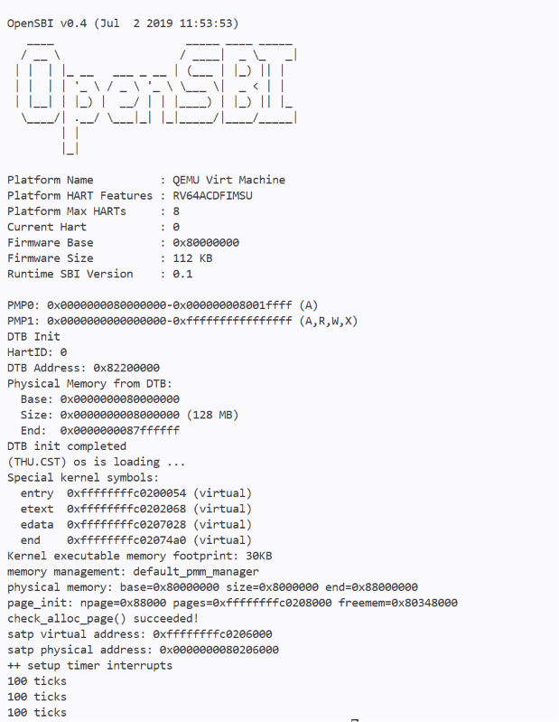
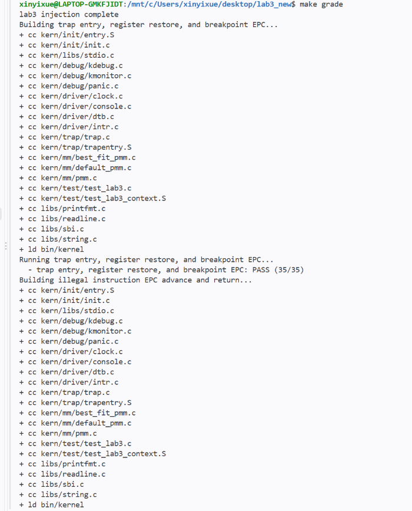
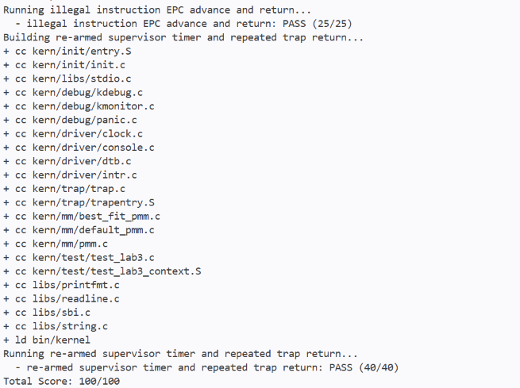

# 实验报告

## 实验基本信息

| 项目 | 内容 |
|------|------|
| **实验名称** | Lab 3: 实现了ucore的中断处理机制|
| **小组成员** | 2510943-张艺涵、2513907-薛欣宜、2513447-黄天怡 |
| **完成日期** | 2026-11-06 |

### 小组分工

练习如何分工？

| 成员 | 负责的练习/模块 |
|------|----------------|
| 2510943-张艺涵 | 功能模块一：Trap 上下文恢复与 Trap 入口功能 |
| 2513907-薛欣宜 | 功能模块二：中断处理功能 |
| 2513447-黄天怡 | 功能模块二：异常处理功能 |

实验报告如何分工？

成员一负责功能模块一的实验内容与实现报告撰写，成员二和成员三负责功能模块二的中断与异常处理功能的实验内容与实现报告撰写部分，同时，成员二负责基本信息和总结部分，成员三负责实验整体逻辑分析。


---

## 一、实验目的

本实验的主要目的是：

1. **理解 RISC-V 的中断与异常处理机制。** 了解 Trap 的基本概念、RISC-V 特权级以及相关寄存器的作用，掌握 CPU 发生中断或异常后如何进入内核进行处理。

2. **掌握 Trap 上下文的保存与恢复过程。** 理解为什么需要保存寄存器状态，学习利用 TrapFrame 结构体存储上下文，并通过汇编代码实现寄存器的保存、恢复和程序返回。

3. **掌握中断与异常的具体处理流程。** 理解 Trap 入口、分发和处理函数之间的关系，实现时钟中断、非法指令异常和断点异常的处理，建立完整的 Trap 处理流程。

4. **学习使用 AI 辅助完成操作系统实验。** 通过分析实验要求和已有代码，设计合理的 Spec 和 Prompt，引导 AI 完成相应功能，并通过编译、运行和测试检查代码的正确性。
---

## 二、实验环境

你们使用的 AI 工具

| 成员 | AI 编程工具 | 底层模型 | 备注 |
|------|------------|---------|------|
| 成员一：[2510943-张艺涵] | Claude Code(终端) DeepSeek-V4-Flash | deepseek-v4-pro）| |
| 成员二：[2513447-黄天怡] | Codex | GPT-6 Sol| |
| 成员三：[2513907-薛欣宜] |Codex | GPT-6 Sol | 通过 Codex 答疑、核对启动流程并辅助整理报告 |


---

## 三、实验整体逻辑分析

### 2.1 本章节的逻辑主线

本章实验围绕 RISC-V 架构下的中断与异常处理机制 展开，主要解决操作系统如何响应突发事件，并在处理完成后恢复原程序执行的问题。

在正常运行过程中，CPU 按照程序指令依次执行任务。但是，当出现时钟中断、非法指令或断点异常等情况时，CPU 需要暂停当前程序，转而执行对应的处理程序。

为了保证原程序能够正常恢复，操作系统需要先保存被中断程序的执行状态，再根据 Trap 的类型进行相应处理，最后恢复之前保存的状态并返回原程序。

因此，本实验按照 “Trap 上下文保存与恢复 → Trap 入口与返回 → 中断与异常处理” 的主线展开。

其中，TrapFrame 负责保存程序的上下文，trapentry.S 负责底层的入口与返回，trap.c 则负责判断 Trap 类型并执行具体处理。三个部分相互配合，最终形成完整的 Trap 处理机制。

### 2.2 功能的逐步实现

1. **首先，理解 TrapFrame 并完善上下文恢复功能。**

当 CPU 发生 Trap 时，原程序的寄存器状态可能被后续处理程序修改。因此，在进入处理函数之前，需要先保存这些状态。

实验已经提供了 SAVE_ALL，用于将通用寄存器和部分控制状态寄存器保存到 TrapFrame 中。我们需要根据已有的保存方式，实现对应的 RESTORE_ALL，确保处理结束后能够正确恢复原程序的执行状态。

这一步是整个实验的基础，因为只有正确保存和恢复上下文，才能保证 Trap 处理不会破坏原程序。

2. **接着，实现 Trap 入口与 C 语言处理函数的连接。**

在完成上下文恢复功能后，需要完善 trapentry.S 中的 __alltraps。

该部分首先利用 SAVE_ALL 保存现场，然后将 TrapFrame 的地址作为参数传递给 trap()，使程序从汇编代码进入 C 语言编写的处理函数。

当 trap() 执行结束后，再通过 __trapret 和 RESTORE_ALL 恢复现场，最后执行 sret 返回原程序。

通过这一步，建立了完整的 Trap 进入和返回流程，为后续处理中断和异常提供了基础。

3. **然后，实现中断处理功能。**

在 trap.c 中，通过 trap_dispatch() 判断当前 Trap 属于中断还是异常，再调用对应的处理函数。

对于中断部分，主要实现 interrupt_handler()，其中重点是时钟中断。

当时钟中断发生时，程序调用 clock_set_next_event() 设置下一次时钟事件，并通过 ticks++ 记录中断次数。

当计数达到 TICK_NUM 的整数倍时，输出统计信息；累计输出达到 SHUTDOWN_AFTER 次后，调用关机接口结束运行。

通过时钟中断的连续触发，可以检验中断处理和上下文恢复机制是否正常工作。

4. **最后，实现异常处理功能。**

在 exception_handler() 中，根据 tf->cause 判断异常类型，主要完成非法指令异常和断点异常的处理。

处理过程中，除了输出对应的异常信息，还需要修改 tf->epc，使程序返回时能够跳过已经触发异常的指令，避免重复进入异常处理程序。

需要注意的是，不同异常指令的长度可能不同，因此要根据实际指令长度调整返回地址。

完成上述功能后，系统就能够正确区分中断和异常，执行对应处理，并在处理结束后恢复原来的执行状态。

---

## 四、实验内容与实现

### 功能模块一：Trap 上下文恢复与 Trap 入口功能

**负责人：** [2510943-张艺涵]

#### 模块功能描述

**需要实现/修改的函数及代码：**

1.  `RESTORE_ALL`：汇编宏，负责恢复 Trap 发生前保存的寄存器和 CSR 状态。
2.  `__alltraps`：Trap 统一入口，负责保存现场后调用 C 语言处理函数
    `trap()`。

**功能说明：**

本模块主要实现 RISC-V 中断和异常处理的底层入口与返回机制，使 CPU 发生
Trap 后能够保存当前执行现场，进入 C
语言处理函数，并在处理完成后恢复原来的执行状态。

具体包括两个部分：

1.  在 `__alltraps` 中调用已有的 `SAVE_ALL` 保存通用寄存器和 CSR
    状态，然后将当前栈指针作为 TrapFrame 地址，通过 `a0` 传递给
    `trap()`，完成从汇编到 C 语言处理函数的衔接。
2.  在 `RESTORE_ALL` 中从 TrapFrame 中恢复 `sstatus`、`sepc`
    和通用寄存器，为最后执行 `sret` 返回原来的执行流做好准备。

本模块是后续异常处理和中断处理的基础。其他模块完成具体处理函数后，均需要通过本模块提供的入口和返回机制完成整个
Trap 处理流程。

#### 最终提示词

以下是经过调整后最终使用的提示词：

``` text
[PROMPT]

任务：
完成 Lab3 功能模块一：Trap 上下文恢复与 Trap 入口功能。

需要修改 kern/trap/trapentry.S，补充 RESTORE_ALL 和 __alltraps 两处代码。

本模块主要完成 Trap 发生后的上下文恢复，以及汇编代码到 C 语言处理函数 trap(struct trapframe *tf) 的调用衔接，使系统能够完成 Trap 进入、保存上下文、处理 Trap、恢复上下文和返回的完整过程。

操作要求：
1. 直接修改项目中的实际文件，不要只给出代码。
2. 修改前先阅读相关代码，主要包括 trapentry.S、trap.h、trap.c、riscv.h，以及相关测试文件。
3. 以当前项目的实际代码为准，不要直接套用其他版本的 ucore。
4. 只修改 trapentry.S 中两个标记为 lab3 function1 YOUR CODE 的位置。
5. 保留已经完成的 SAVE_ALL、struct trapframe、trap() 和原有的返回流程，不要修改其他功能模块的代码。

输出要求：
完成后检查代码是否与现有的上下文保存方式、TrapFrame 布局和 RISC-V 函数调用约定一致，并尽可能进行编译和测试。最后说明修改了哪些位置、实现了什么功能，以及实际进行了哪些检查。

[RELY]

1. 当前项目使用 RISC-V 64 位架构，libs/riscv.h 中已经定义了 LOAD、STORE 和 REGBYTES 等宏，可以直接使用。

2. trapentry.S 中已经实现 SAVE_ALL，负责保存 Trap 发生时的通用寄存器和相关 CSR。执行完成后，sp 指向 TrapFrame 的起始位置。

3. struct trapframe 定义在 kern/trap/trap.h 中，包含通用寄存器以及 status、epc、badvaddr、cause 等字段。需要结合实际结构体定义确定各字段的偏移，保证汇编访问顺序与 C 语言结构体布局一致。

4. C 语言处理函数已经存在，接口为：
void trap(struct trapframe *tf);

5. 根据 RISC-V 函数调用约定，第一个参数通过 a0 传递，函数调用使用 ra 保存返回地址，sp 用作栈指针，调用前需要满足 16 字节对齐要求。

6. 当前 trapentry.S 已经提供了基本流程：
__alltraps -> SAVE_ALL -> 调用 trap() -> __trapret -> RESTORE_ALL -> sret

[GUARANTEE]

本次需要完成两个部分：

1. RESTORE_ALL：根据 TrapFrame 中保存的信息恢复需要恢复的通用寄存器和相关 CSR。

2. __alltraps：将当前 TrapFrame 的地址作为参数传递给 trap()，并保证函数返回后能够正确进入 __trapret。

不得修改 SAVE_ALL、struct trapframe 和 trap() 的接口，也不要修改其他模块。

[SPECIFICATION]

1. RESTORE_ALL

Pre-Condition：
SAVE_ALL 已经完成上下文保存，当前 sp 指向有效的 TrapFrame。C 语言处理函数可能会修改 TrapFrame 中的部分内容。

Post-Condition：
正确恢复 Trap 发生前的寄存器状态和返回所需的 CSR，最终能够通过 sret 正确返回。

具体要求：
- 恢复的寄存器和 CSR 必须与 SAVE_ALL 的保存布局对应，不能遗漏需要恢复的寄存器。
- 注意 sp 的特殊处理，必须在不再需要访问 TrapFrame 后再恢复原始 sp。
- 如果恢复过程中使用了临时寄存器，也必须保证其原始值能够正确恢复。
- sstatus 和 sepc 必须使用 TrapFrame 中当前保存的值，不能忽略 C 语言处理函数对它们的修改。
- 不要擅自修改返回地址或跳过触发 Trap 的指令。

2. __alltraps

Pre-Condition：
SAVE_ALL 已经执行完毕，当前 sp 指向 TrapFrame 的起始位置。

Post-Condition：
将当前 TrapFrame 正确传递给 trap(struct trapframe *tf)，处理函数返回后继续进入 __trapret。

具体要求：
- 正确传递 TrapFrame 地址，不能传递错误的指针。
- 调用 trap() 前保证 sp 正确，并满足 RISC-V 64 位函数调用约定的栈对齐要求。
- trap() 返回后，sp 必须仍然指向原来的 TrapFrame，不能因为函数调用导致栈指针发生偏移。
- 保证原有的寄存器信息不会因为函数调用而丢失。

验证要求：

1. 阅读 tools/test_lab3_context.S，了解其中对通用寄存器保存和恢复的测试。
2. 阅读 tools/test_lab3.c，了解 test_lab3_exception_context() 的调用过程。
3. 阅读 tools/grade.sh，了解 Test 1 的具体验收要求。
4. 修改完成后检查代码，确认只修改了指定的两个位置。
5. 尽可能单独进行汇编编译检查，再根据项目实际情况尝试完整编译或测试。
6. 如果完整测试因为 Lab2 代码尚未迁移或其他功能模块尚未完成而无法通过，不要擅自修改其他模块，应说明具体原因。

最后说明代码修改情况、实现思路和实际测试结果。没有实际执行的测试不要声称已经通过。
```

#### 实现迭代过程

本模块经过 1 次迭代，过程如下：

##### 第一次迭代（最终版本）

**最终结果：**

- ✅ 完成 `RESTORE_ALL` 宏和 `__alltraps`
入口的修改。初步独立检查通过；
- ✅ 在其他模块完成并合并后，随小组进行了整体测试。与本模块直接相关的上下文恢复测试通过；
- ✅ 寄存器恢复及
Trap 返回正常，验证了本模块能够与异常处理流程正确配合。

**关键实现点总结：**

1.  恢复 CSR 时先使用临时寄存器读取 TrapFrame
    中的值并写回，之后再恢复通用寄存器，避免临时寄存器的原值丢失。
2.  将 `sp` 放在最后恢复，保证恢复过程中始终能够通过当前栈指针访问
    TrapFrame。
3.  利用 RISC-V 调用约定，通过 `a0` 传递第一个函数参数，实现汇编入口与 C
    语言处理函数之间的衔接。

---


**负责人：** 2513907-薛欣宜
### 功能模块：中断与异常处理功能——中断部分

#### 模块功能描述

**需要实现或修改的函数**

`kern/trap/trap.c`

```c
void interrupt_handler(struct trapframe *tf);
```

**功能说明**

- **中断识别与分发**。`trap_dispatch()` 将中断交给 `interrupt_handler()`。处理函数屏蔽 `tf->cause` 的最高位，提取中断编号，保留原始 `tf->cause`。
- **时钟中断**。收到 `IRQ_S_TIMER` 后，调用 `clock_set_next_event()` 安排下一次时钟事件，并将 `ticks` 加 1。每累计 `TICK_NUM` 次时钟中断输出一次统计信息。完成第 `SHUTDOWN_AFTER` 次统计输出后，调用 `sbi_shutdown()` 关机。
- **其他中断**。已知中断按类型输出提示，未知中断调用 `print_trapframe(tf)` 输出现场。非时钟中断保持时钟计数和下一次时钟事件不变。
- **返回位置**。保留 `tf->epc`，由统一的 Trap 返回流程将其写回 `sepc`，再通过 `sret` 从原定位置继续执行。

实现时沿用原有函数签名和 `struct trapframe`，修改范围限于 `interrupt_handler()` 及必要的局部定义。

#### 最终提示词

以下是经过迭代优化后，最终成功实现该功能的提示词：

````markdown
[Prompt]
**任务**
- 完成中断处理模块 void interrupt_handler(struct trapframe *tf)，根据 Trap 原因正确分类和处理中断。

**操作要求**
- 直接修改并保存项目中的 kern/trap/trap.c，保持原有架构。

**输出要求**
- 简要说明修改位置和验证结果，未运行的测试如实注明。

[rely]
1. 宏定义：
- IRQ_S_TIMER：S 模式时钟中断编号。
- TICK_NUM：每累计多少次时钟中断输出一次统计信息。
- SHUTDOWN_AFTER：累计输出多少次统计信息后关机。
- 其他中断编号复用框架已有宏。阈值和输出格式以实验要求及测试为准；若关机阈值缺失，不自行猜测。

2. 数据结构与变量：
- 复用 struct trapframe，通过 tf->cause 提取中断编号。
- 复用 ticks，记录已处理的时钟中断次数。
- 保持 tf->epc 和其他现场字段不变。

3. 已有函数：
- trap_dispatch()：沿用已有分发逻辑，由它将中断交给 interrupt_handler()。
- clock_set_next_event()：安排下一次时钟事件。
- 复用框架已有的统计和提示输出接口。
- print_trapframe(tf)：输出完整 Trap 现场。
- sbi_shutdown()：使用 libs/sbi.h 提供的关机接口。

4. 修改范围：
- 仅实现 interrupt_handler() 及必要的局部辅助定义。
- 不修改函数签名、TrapFrame 布局、分发与恢复流程，以及其他函数或模块。

[GUARANTEE]
- 实现 void interrupt_handler(struct trapframe *tf)。
- 正确处理时钟中断、其他已知中断和未知中断。
- 未关机时正常返回统一 Trap 恢复流程，保留原执行流的返回位置。

[SPECIFICATION]
1. 中断识别：
- 从 tf->cause 中去除表示“中断”的最高标志位，提取具体中断编号。
- 使用局部变量保存编号，不修改 tf->cause。

2. 时钟中断：
- 识别 IRQ_S_TIMER 后，调用 clock_set_next_event()，设置下一次时钟事件。
- 每处理一次时钟中断，ticks 恰好增加一次。
- 当更新后的 ticks 达到 TICK_NUM 的整数倍时，按规定格式输出一次统计信息。
- 累计输出达到 SHUTDOWN_AFTER 后，先完成该次输出，再调用 sbi_shutdown()。关机条件按输出次数判断。

3. 其他中断：
- 已知中断按类型输出框架要求的提示。
- 未知中断调用 print_trapframe(tf) 输出完整现场。
- 非时钟中断不更新 ticks，不重新设置时钟事件。

4. 返回位置与 PC：
- 保持 tf->epc 不变，不跳过原执行流中的指令。
- 正常返回后，由 RESTORE_ALL 将 tf->epc 写回 sepc，再由 sret 令 PC = sepc，从原定位置继续执行。
- 不直接修改硬件 sepc，不自行恢复上下文、执行 sret 或改变返回特权级。

5. 验收条件：
- 时钟中断能够持续按期触发，计数、输出和关机条件符合要求。
- 其他中断能够正确区分并输出提示或完整现场。
- 正常返回时不破坏被打断执行流的寄存器与返回状态。
````


### 功能模块二：中断与异常处理——异常处理部分

#### 模块功能描述

**需要实现/修改的函数：**

```c
void exception_handler(struct trapframe *tf);
```

**功能说明：**

本模块负责处理 CPU 执行过程中发生的异常，是整个 Trap 处理机制的一部分。

当异常发生时，系统首先通过 `trapentry.S` 保存上下文，再由 `trap_dispatch()` 将异常交给 `exception_handler()` 处理。

本模块主要完成以下功能：

1. **非法指令异常：** 识别 `CAUSE_ILLEGAL_INSTRUCTION`，输出异常地址，并根据实际指令长度修改 `tf->epc`，使程序跳过非法指令。
2. **断点异常：** 识别 `CAUSE_BREAKPOINT`，输出断点地址，区分 16 位和 32 位指令，正确调整返回位置。
3. **其他异常：** 调用 `print_trapframe(tf)` 输出现场信息，不额外修改程序状态。

处理结束后，函数返回统一的 Trap 返回流程，通过 `RESTORE_ALL` 恢复上下文，最后执行 `sret` 返回程序。

本模块的关键是**正确识别异常类型，并调整异常处理后的程序执行位置，避免重复触发同一异常。**

#### 最终提示词

以下是用于完成异常处理模块的最终提示词：

```markdown
[Prompt]

**任务**
- 完成异常处理模块 void exception_handler(struct trapframe *tf)，根据 Trap 原因正确分类和处理异常。

**操作要求**
- 直接修改并保存项目中的 kern/trap/trap.c。

**输出要求**
- 简要说明修改位置和验证结果，未运行的测试如实注明。

[RELY]

1. 宏定义：
- CAUSE_ILLEGAL_INSTRUCTION：非法指令异常。
- CAUSE_BREAKPOINT：断点异常。

2. 数据结构：
- 复用 struct trapframe，不修改布局。
- tf->cause：判断异常类型。
- tf->epc：读取和调整 Trap 返回位置。

3. 已有函数：
- print_trapframe(tf)：输出完整现场。
- cprintf() 等已有输出接口。
- 具体定义和输出格式以框架及测试要求为准。

4. 修改范围：
- 仅修改 exception_handler() 及必要的局部辅助定义。
- 不修改函数签名、已有分发逻辑、其他函数或内核模块。

[GUARANTEE]

- 实现 void exception_handler(struct trapframe *tf)。
- 正确处理非法指令、断点及其他异常，并与统一 Trap 返回流程衔接。
- 除规定的 tf->epc 调整外，保持其他现场不变。

[SPECIFICATION]

1. 非法指令异常：
- 按规定格式输出 “Illegal instruction at ...”，包含调整前的异常地址。
- 根据实际指令长度更新 tf->epc，跳过触发指令。

2. 断点异常：
- 按规定格式输出 “Breakpoint at ...”，包含调整前的断点地址。
- 区分 16 位压缩断点和 32 位普通断点，分别增加 2 或 4 字节。

3. 指令长度：
- 根据实际编码判断实验涉及的 16/32 位指令长度。
- 不按异常类型固定长度，不统一增加固定偏移。

4. 其他异常：
- 调用 print_trapframe(tf)，保持 tf->epc 不变，不额外实现恢复策略。

5. 返回位置与 PC：
- 设触发异常的指令地址为 A，指令长度为 L。
- 对本实验要求跳过的非法指令和断点异常，将 tf->epc 更新为 A + L；其他异常保持不变。
- 修改 tf->epc 不会立即改变 PC，处理函数仍正常执行并返回。
- 后续 RESTORE_ALL 将 tf->epc 写回 sepc，sret 再令 PC = sepc，使指定异常返回后执行下一条指令。
- 不直接修改硬件 sepc，不自行恢复上下文、执行 sret 或改变返回特权级。

6. 验收条件：
- 输出符合规定格式。
- 指定异常返回后继续执行下一条指令，不反复触发同一异常。
- 其他异常输出现场且不改变返回位置。
- 不破坏被打断执行流的寄存器与返回状态。
```

#### 实现迭代过程

本模块采用一次完整提示词进行实现。提示词重点明确了异常分类、指令长度判断、返回地址调整以及修改范围等要求。

##### 第一次迭代

**设计思路：**

首先，向 AI 提供 `exception_handler()` 的函数签名，以及 `tf->cause`、`tf->epc` 等已有接口，明确只需要实现异常处理，不修改其他 Trap 处理逻辑。

其次，在 `[SPECIFICATION]` 中分别规定非法指令异常、断点异常和其他异常的处理方式。

其中，重点强调不能直接将 `tf->epc` 固定增加 4，而需要根据指令编码判断长度。这是因为 RISC-V 同时支持 16 位压缩指令和 32 位普通指令，如果返回地址调整错误，可能导致程序执行位置异常。

最后，明确异常处理函数只负责更新 TrapFrame，不直接执行上下文恢复和 `sret`，避免破坏已有的 Trap 返回机制。

**本次提示词的关键设计：**

1. **通过 `[RELY]` 明确依赖关系：** 提供已有宏、数据结构和函数，要求 AI 复用框架接口。
2. **通过 `[GUARANTEE]` 限制实现范围：** 只修改异常处理相关代码，保持其他寄存器状态和处理逻辑不变。
3. **通过 `[SPECIFICATION]` 明确处理细节：** 区分不同异常，正确计算指令长度，并规定 `tf->epc` 的修改方式。
4. **明确返回流程：** 将异常处理与 `RESTORE_ALL`、`sret` 联系起来，避免 AI 在处理函数内部重复执行 Trap 返回操作。

**最终结果：**

通过本次提示词设计，异常处理模块的实现要求已经明确，包括异常类型判断、信息输出、指令长度识别和返回地址更新。


**关键改进点总结：**

1. 明确区分非法指令异常、断点异常和其他异常的处理方式，避免遗漏分支。
2. 在 `[SPECIFICATION]` 中强调根据实际指令长度调整 `tf->epc`，避免固定偏移导致返回地址错误。
3. 明确 `tf->epc`、`sepc` 和 `sret` 之间的关系，确保异常处理能够正确衔接统一的 Trap 返回流程。
4. 限定代码修改范围，避免 AI 修改其他已经实现的功能。


---

## 五、测试与验证





## 六、实验总结与收获

**1. 本实验知识点与 OS 原理知识点的联系和区别**

| 本实验知识点 | OS 中知识点 | 关系 | 差异 |
|---|---|---|---|
| Trap 上下文保存与恢复 | 上下文保存与恢复 | 二者都是为了保留程序执行现场，使程序能够在暂停后继续执行。 | 本实验主要处理一次中断或异常发生时的现场保存与恢复，通常返回原来的执行流；进程上下文切换则可能切换到另一个进程，还需要处理进程相关的其他状态。 |
| Trap 入口与返回 | 中断和异常处理机制 | 二者都依赖硬件提供的 Trap 机制，使 CPU 从正常执行流程进入内核处理流程，并在处理完成后返回。 | OS 原理主要介绍中断和异常处理的通用机制，本实验则结合 RISC-V 架构，具体实现了 Trap 入口设置、上下文保存、异常分发和现场恢复等过程。 |
| `stvec`、`scause` 与 `trap_dispatch()` | 中断与异常的响应和分发 | 中断由外部事件异步触发，异常由当前指令同步触发。实验通过 `stvec` 设置统一入口，保存 `scause` 后，由 `trap_dispatch()` 区分中断和异常，再交给相应的处理函数。 |
| `trapframe`、`SAVE_ALL` 与 `sret` | 现场保护与恢复 | 实验将寄存器和返回地址等信息保存到栈上的 `trapframe` 中，处理结束后恢复现场，通过 `sret` 返回。时钟中断保留 `tf->epc`，从原定位置继续执行。实验中的断点和非法指令处理则按指令长度更新 `tf->epc`，跳过触发异常的指令。 |
| 定时器中断与 `ticks` | 时钟管理 | 操作系统可利用时钟中断计时和驱动调度。实验在每次时钟中断中安排下一次时钟事件，并累计 `ticks`、定期输出统计信息，体现了周期性时钟管理的基本机制。 |
| `local_intr_save()` 与 `local_intr_restore()` | 临界区保护 | 分配器进入临界区前保存并关闭当前 hart 的中断，退出时恢复原有中断状态，以避免同一 hart 的中断处理打断分配器操作。多个 hart 访问同一份共享数据时，还需要跨核同步。 |

**2. OS 原理中重要但本实验没有对应上的知识点**

- **进程调度与切换**。例如时间片耗尽后选择下一个进程，保存当前进程的上下文并恢复下一个进程的上下文。
- **系统调用**。例如用户程序通过 `ecall` 请求内核服务，内核根据系统调用号分发请求、检查参数并返回结果。
- **缺页异常恢复**。例如根据缺页原因建立页表映射或调入页面，处理完成后重试触发缺页的指令。
- **设备中断的完整处理**。例如识别中断来源、确认中断，并由设备驱动处理相应的 I/O 事件。

### AI 协作开发的经验

- 本次开发中，先明确需要修改的代码位置和功能范围，再让 AI 阅读已有的
`SAVE_ALL`、`struct trapframe`
等定义后完成指定部分，避免对其他模块造成影响。
- 生成代码后，不能只看 AI
的说明，还需要使用项目工具链编译，并通过反汇编检查寄存器偏移和函数调用方式。对于汇编代码，结合
TrapFrame 的结构布局逐项核对，比单纯依赖 AI 判断更可靠。


---

