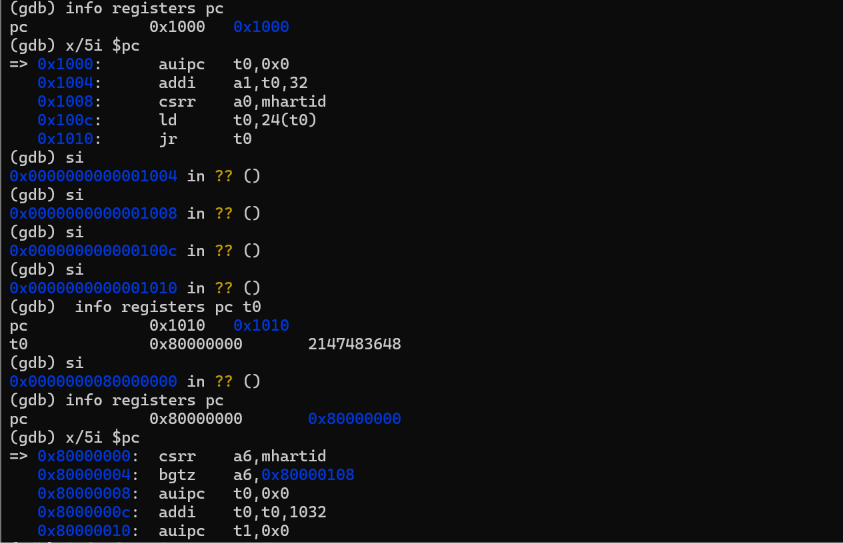
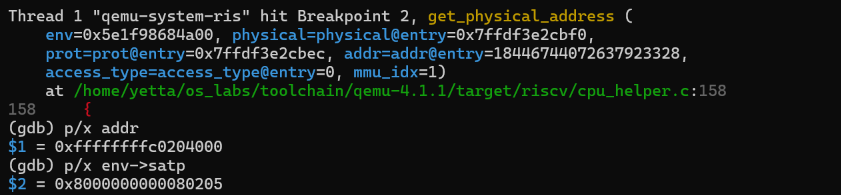
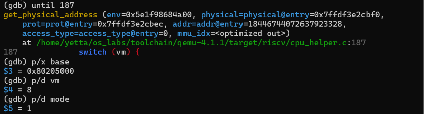
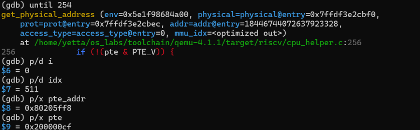
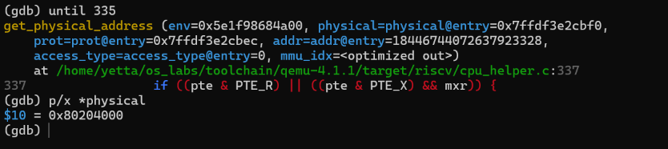
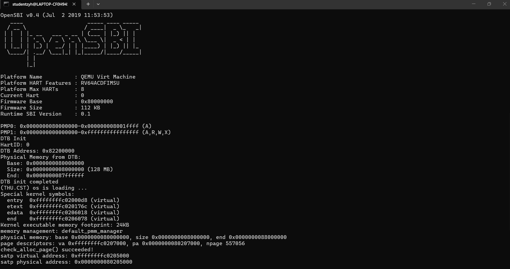
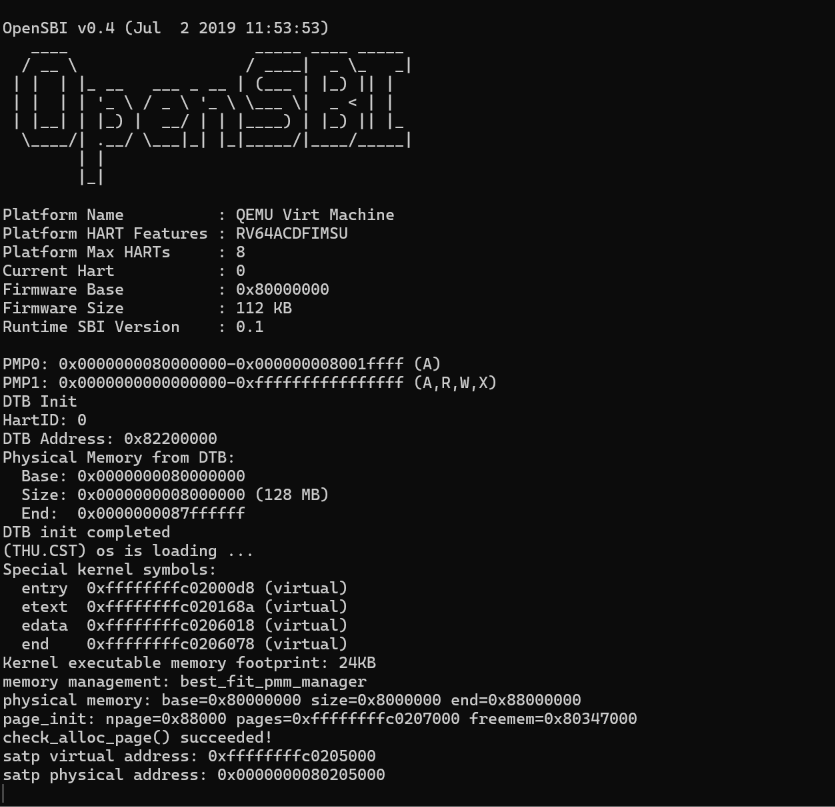
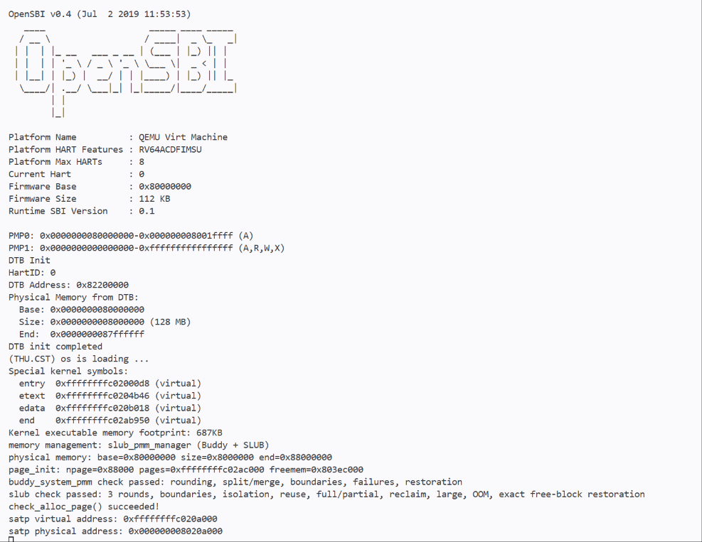
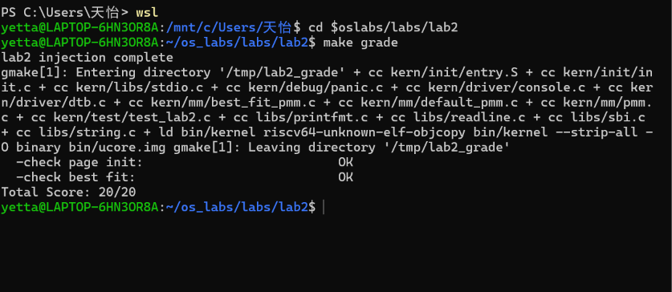

# 实验报告

## 实验基本信息

| 项目 | 内容 |
|------|------|
| **实验名称** | Lab 2：物理内存和页表 |
| **小组成员** | [2510943-张艺涵]、[2513447-黄天怡]、[2513907-薛欣宜] |
| **完成日期** | [2026-10-23] |

### 小组分工

**练习分工：**

| 成员 | 负责的练习/模块 |
|------|----------------|
| 成员一：[2510943-张艺涵] | 任务一：物理内存探测与页描述符初始化——实现 `page_init()` |
| 成员二：[2513447-黄天怡] | 任务二：First-Fit 算法分析与 Best-Fit 连续物理页分配器实现 |
| 成员三：[2513907-薛欣宜] | 任务三：Buddy System 分配器及其测试；扩展 Challenge：SLUB 任意大小内存对象分配及测试 |

**实验报告分工：** 成员一负责实验基本信息、前三部分和第四部分的任务一；成员二负责第四部分的 First-Fit、Best-Fit 相关内容及测试与验证；成员三负责第四部分的 Buddy System、SLUB Challenge 相关内容及实验总结与收获

---

## 一、实验目的

本实验在 Lab 1 已能够启动 uCore 内核的基础上，学习物理内存的探测、初始化和分配，并结合 RISC-V 的分页机制理解物理内存与虚拟内存的关系。主要目标如下：

1. **掌握物理内存探测和初始化方法。** 通过设备树获取物理内存范围，建立 `Page` 描述符数组，正确区分内核占用页面和可分配页面。
2. **理解并实现连续物理页分配算法。** 阅读现有 First-Fit 分配器，理解空闲链表的初始化、页面分配、回收与合并；在此基础上实现 Best-Fit，并比较不同查找策略的特点。
3. **理解伙伴系统及小块内存分配。** 通过 Buddy System 学习按 2 的幂次组织、拆分与合并空闲块；通过选做的 SLUB Challenge 了解在页级分配之上管理不同大小内存对象的方法。
4. **理解物理内存管理与页表机制的联系。** 结合 RISC-V Sv39 分页，区分虚拟地址、物理地址、物理页号和页面描述符，理解页表映射与物理页分配分别解决的问题。
5. **实践 AI 辅助操作系统开发。** 按四段式提示词规范描述功能、接口和边界条件，检查 AI 生成的代码，并通过编译和 QEMU 测试验证结果

---

## 二、实验环境

**AI 编程工具：**

| 成员 | AI 编程工具 | 底层模型 | 备注 |
|------|------------|----------|------|
| 成员一：[2510943-张艺涵] | Claude Code（终端 Agent） | deepseek-v4-pro）| |
| 成员二：[2513447-黄天怡] | Codex/Chatgpt | GPT-6 | |
| 成员三：[2513907-薛欣宜] | Codex | GPT-6 Sol | 通过 Codex 答疑、核对启动流程并辅助整理报告 |

---

## 三、实验整体逻辑分析

### 2.1 本章节的逻辑主线

本实验围绕**如何让内核识别、组织和分配物理内存**展开。主要解决了操作系统如何确定哪些物理内存可以使用，以及如何高效地分配和回收这些内存的问题。

实验一已经使内核能够在 QEMU 上启动，但启动成功不代表内核已经知道哪些物理页可以安全分配。设备树只能提供 RAM 的位置和大小，其中一部分物理内存已经被 OpenSBI、内核镜像和管理数据占用。因此，首先要探测物理内存并建立 `Page` 描述符，保留已使用页面，再将可用页面交给分配器。

物理内存管理器通过 `struct pmm_manager` 的函数指针接口提供初始化、分配、释放和检查等操作。首先理解框架已有的 First-Fit，再实现 Best-Fit，可以在保持基本接口相同的前提下比较两种选择空闲块的方式。Buddy System 则从另一种角度组织空闲内存：按 2 的幂次管理块，分配时拆分、释放时合并。任务三的 SLUB Challenge 进一步面向任意大小的内存对象，在页级分配之上提供更细粒度的分配能力。

### 2.2 功能的逐步实现

1. 首先实现物理内存探测与初始化功能 → 因为操作系统必须先知道物理内存的范围，以及哪些页面已经被占用、哪些页面可以使用，才能为后续的内存分配提供基础。
2. 接着理解 First-Fit 算法并实现 Best-Fit 分配器 → 在完成物理页初始化后，需要能够对空闲物理页进行分配和回收。通过分析已有的 First-Fit 实现，再完成 Best-Fit，可以掌握连续物理页分配的基本过程，并理解不同空闲块选择策略的区别。
3. 然后实现 Buddy System 伙伴分配算法 → 在掌握基本连续物理页分配方法后，进一步学习按照 2 的幂次组织空闲块，通过拆分和伙伴合并实现物理内存管理，理解另一种内存分配策略。
4. 最后补充 SLUB 内存分配扩展功能 → 前面的算法主要以物理页或连续页块为单位进行分配，而实际系统还需要分配小于一页、大小不同的内存对象。因此在页级分配的基础上进一步实现 SLUB，并通过相应测试验证内存对象的分配与释放，形成从物理页管理到小块内存分配的完整过程。

---

## 四、实验内容与实现

### 功能模块一：物理内存初始化功能

**任务：** 物理内存探测与 Page 描述符初始化  
**负责人：** [2510943-张艺涵]

#### 模块功能描述

**需要实现/修改的函数：**

```c
static void page_init(void);  // kern/mm/pmm.c
```

**功能说明：**

`page_init()` 由 `pmm_init()` 调用，负责从设备树读取物理内存信息，确定内核能够管理的物理页范围，并在内核镜像之后建立 `Page` 描述符数组。由于 OpenSBI、内核及描述符数组已经占用了部分物理页面，初始化时需要将这些页面保留，仅把后面剩余的完整空闲页通过 `init_memmap()` 注册到当前物理内存管理器中。本任务完成后使用已有的 First-Fit 管理器完成初始验证。

**实现思路：** 代码先检查设备树提供的内存范围，对超过框架上界的部分进行限制；设置内核虚拟地址与物理地址之间的固定偏移，计算 `npage`，并将 `pages` 放置在链接符号 `end` 之后的页对齐位置。随后检查描述符数组是否能够完整放入有效内存，初始化描述符状态并统一标记为 Reserved。最后将描述符数组结束位置向上按页对齐，计算完整空闲页面数量，有完整页面时调用 `init_memmap()`。其中，`pages[0]` 对应物理页号 `nbase`，调用 `pa2page()` 时必须保持物理页号和数组下标的对应关系。

#### 最终提示词

以下是本次任务实际使用并成功生成通过验证的 `page_init()` 的提示词：

````markdown
[PROMPT]

**任务：** 修改 `kern/mm/pmm.c`，完成物理内存探测与 Page 描述符初始化功能。根据设备树提供的物理内存信息，建立可管理物理页的描述符布局，并将排除 OpenSBI、内核镜像和描述符数组占用空间后的完整空闲页面交给当前物理内存管理器管理。

**操作要求：** 必须直接修改项目中的实际文件，在 `//lab2 function1 YOUR CODE` 标记处完成实现。保留已有代码，不修改其他任务、分配算法及测试函数。

**输出要求：** 使用下面提供的依赖、接口和功能规格，以工程实际代码为准完成实现。完成后简要说明修改位置、实现思路和代码检查结果。

[RELY]

**1. 相关宏定义**

来自 `riscv.h`、`memlayout.h` 和 `mmu.h`：

```c
#define DRAM_BASE               0x80000000
#define KERNBASE                0xFFFFFFFFC0200000
#define PHYSICAL_MEMORY_END     0x88000000
#define PHYSICAL_MEMORY_OFFSET  0xFFFFFFFF40000000
#define KERNEL_BEGIN_PADDR      0x80200000

#define PGSIZE                  4096
#define PGSHIFT                 12
#define PPN(la)                 (((uintptr_t)(la)) >> PGSHIFT)
```

**2. 数据结构和全局变量**

```c
struct Page {
    int ref;
    uint64_t flags;
    unsigned int property;
    list_entry_t page_link;
};

struct Page *pages;
size_t npage;
uint64_t va_pa_offset;
const size_t nbase = DRAM_BASE / PGSIZE;
```

其中，`pages[0]` 对应物理页号 `nbase`，描述符数组覆盖的物理页号范围为 `[nbase, npage)`。

**3. 已有函数与工具**

```c
uint64_t get_memory_base(void);
uint64_t get_memory_size(void);

PADDR(kva)
pa2page(pa)
SetPageReserved(page)
PageReserved(page)

static void init_memmap(struct Page *base, size_t n);

ROUNDUP()
ROUNDDOWN()
panic()
cprintf()
```

链接脚本提供内核结束符号 `end`。

`PADDR()` 根据 `va_pa_offset` 将内核虚拟地址转换为物理地址；`pa2page()` 根据物理页号和 `nbase` 定位 Page 描述符。

`SetPageReserved()` 仅设置保留标志位，不会清零其他字段。

当前 `default_init_memmap()` 要求传入页面已处于 Reserved 状态，且页面数量 `n > 0`。

`KADDR` 当前处于注释状态，不应使用。

[GUARANTEE]

必须实现以下函数：

```c
static void page_init(void);
```

保持函数签名和已有接口不变。

[SPECIFICATION]

**Pre-Condition：**

设备树已经初始化，当前 `pmm_manager` 已完成初始化，内核使用现有的虚拟地址映射关系。

**Post-Condition：**

正确初始化 `va_pa_offset`、`npage` 和 `pages`，为可管理范围内的所有物理页建立描述符。OpenSBI、内核镜像和描述符数组占用的页面保持保留状态，剩余完整空闲页面交由当前 `pmm_manager` 管理。

**Case 1：正常物理内存初始化**

设备树提供有效的物理内存信息时，应正确确定物理内存范围，并建立 Page 描述符数组。描述符数组位于内核镜像结束位置之后，且按页对齐。

初始化全部描述符的相关字段，初始时将页面标记为 Reserved，再由当前内存管理器处理真正空闲的页面。

**Case 2：设备树信息异常**

当设备树报告的内存大小为零、内存范围发生地址溢出，或物理内存起点与当前工程固定的 `DRAM_BASE` 不一致时，应终止初始化，不能使用无效的内存信息。

**Case 3：物理内存管理上界**

当设备树报告的内存终点超过 `PHYSICAL_MEMORY_END` 时，应将管理范围限制到该上界。

处理后的内存范围必须有效，能够容纳内核及 Page 描述符数组等必要空间。

**Case 4：描述符数组空间不足**

描述符数组需要覆盖全部可管理物理页，其本身占用的内存也必须排除在空闲区之外。

在写入描述符数组之前，应确认其占用范围位于有效物理内存内，不能因描述符数组空间不足而覆盖其他内存。

**Case 5：完整空闲页的处理**

空闲区应从描述符数组之后开始，并正确处理页面对齐。只允许将完整的、未被占用的物理页注册给分配器。

如果剩余空间不足一个完整页面，不得调用 `init_memmap()`；如果存在完整空闲页，则应保证传入的起始 Page 描述符和页面数量正确。

**Requirements：**

- 正确区分内核虚拟地址、物理地址和物理页号。
- 保持当前 First-Fit 管理器不变。
- 输出必要的物理内存初始化信息，方便后续运行检查。
````

#### 实现迭代过程

本任务的功能代码在第一轮提示词中生成，之后进行了一次独立的测试环境准备与验证交互。

##### 第一次迭代

**遇到的问题：** 
- 问题1：C执行 `make qemu`时，提示 `free_list` 和 `nr_free` 未定义。问题分析：当前 `init_pmm_manager()` 选择的是 First-Fit，但 Makefile 仍会编译 Best-Fit 源文件。Best-Fit 尚未实现造成的是整个工程的构建依赖阻塞。

**问题解决策略：**
- 针对问题1：将工程复制到 `/tmp/lab2-pageinit-...` 独立目录，要求 Claude Code 只在副本内为未完成的 `best_fit_pmm.c` 增加必要的临时占位定义，保持 `pmm_manager` 指向 `default_pmm_manager`，不实现 Best-Fit 算法，不改动 `page_init()` 和测试文件，并提供测试命令。此

##### 第二次迭代

**最终结果：**

经过 [N] 次迭代，该模块最终：
- ✅ 编译通过
- ✅ 所有相关测试通过
- ✅ 功能符合预期

**关键改进点总结：**

 让AI 在副本中补充了 `free_area`、`free_list`、`nr_free` 等必要编译状态，以及仅供链接的 `best_fit_pmm_manager` 占位符号

---

### 功能模块二：物理内存分配功能

**负责人：** 2513447-黄天怡

#### 模块功能描述


**需要实现/修改的函数：**

```c
// First Fit：default_pmm.c
static void default_init(void);
static void default_init_memmap(struct Page *base, size_t n);
static struct Page *default_alloc_pages(size_t n);
static void default_free_pages(struct Page *base, size_t n);
static size_t default_nr_free_pages(void);

// Best Fit：best_fit_pmm.c
static void best_fit_init(void);
static void best_fit_insert_block(struct Page *base);
static void best_fit_init_memmap(struct Page *base, size_t n);
static struct Page *best_fit_alloc_pages(size_t n);
static void best_fit_free_pages(struct Page *base, size_t n);
static size_t best_fit_nr_free_pages(void);

// pmm.c：选择使用的物理内存分配器
static void init_pmm_manager(void);

// 已有测试函数，用于验证，不需要修改
static void basic_check(void);  // 两个分配器文件各有一份
static void default_check(void);
static void best_fit_check(void);
```

**功能说明：**
- 系统作用： 管理空闲物理页，为内核提供连续物理页的分配、回收和空闲页数量查询功能。
- 主要场景： First Fit 选择遇到的第一个足够大的空闲块；Best Fit 选择所有满足要求的空闲块中最小的一块。分配后保留剩余部分，回收时合并地址相邻的空闲块；找不到足够大的连续块时返回 NULL。
- 模块交互： 使用 struct Page 记录页面状态，用双向链表管理空闲块。通过 pmm_manager 接入 pmm.c，由 alloc_pages()、free_pages() 等统一接口调用，为页表等内核功能提供物理页。


#### 最终提示词


````markdown

[PROMPT]

**任务：**

参考 `kern/mm/default_pmm.c` 中的 First-Fit 实现，在 `kern/mm/best_fit_pmm.c` 中实现完整的 Best-Fit 连续物理内存分配器，并在 `kern/mm/pmm.c` 中启用该管理器。

**操作要求：**

1. 必须直接修改项目中的实际文件，而不是仅输出代码。
2. 在 `best_fit_pmm.c` 标记为 `lab2` 和 `YOUR CODE` 的位置补全实现，保留 `lab2` 注释，将 `YOUR CODE` 替换为 `[我的学号]`。
3. 不得修改 `basic_check()` 和 `best_fit_check()` 的任何代码。
4. 除切换物理内存管理器所需的代码外，不得修改 `pmm.c` 的其他逻辑。
5. 可以参考 First-Fit 的初始化、回收和合并逻辑，但分配策略必须改为 Best-Fit。
6. 不引入无关功能，不修改测试标准。

**输出要求：**

完成文件修改后，说明新增的函数、主要实现逻辑和修改位置，并运行项目现有的编译与测试命令进行验证。若测试失败，分析原因并修复，不得通过修改测试函数使测试通过。

[RELY]

请先阅读项目中的以下文件，以真实代码为准：

- `kern/mm/default_pmm.c`：参考 First-Fit 的完整实现。
- `kern/mm/best_fit_pmm.c`：确认需要补全的位置及现有测试。
- `kern/mm/pmm.h`：读取 `struct Page`、`struct pmm_manager` 及相关接口。
- `kern/mm/best_fit_pmm.h`：确认 Best-Fit 管理器的声明。
- `kern/mm/pmm.c`：检查 `init_pmm_manager()` 的实现。
- `libs/list.h` 或项目中实际对应的 `list.h`：确认双向链表操作接口。

本模块需要使用以下结构和机制：

1. `free_area_t`：保存空闲链表及空闲页总数。
2. `struct Page`：通过 `property` 记录空闲块大小，通过 `PG_property` 标记空闲块头页，通过 `page_link` 连接链表。
3. `free_list`：按物理地址升序排列的双向循环链表。
4. `nr_free`：记录当前空闲物理页的总数。
5. `PageReserved()`、`PageProperty()`、`SetPageProperty()`、`ClearPageProperty()` 等页面状态操作。
6. `list_init()`、`list_add()`、`list_add_before()`、`list_del()` 等链表操作。
7. `basic_check()` 和 `best_fit_check()`：已有的正确性测试，其中直接访问 `free_list` 和 `nr_free`，实现必须符合这一状态约定。

所有数据结构、宏定义、函数签名及头文件路径均以项目源码为准，不得自行虚构接口。

[GUARANTEE]

在 `best_fit_pmm.c` 中实现以下主要接口：

```c
static void best_fit_init(void);

static void best_fit_init_memmap(struct Page *base, size_t n);

static struct Page *best_fit_alloc_pages(size_t n);

static void best_fit_free_pages(struct Page *base, size_t n);

static size_t best_fit_nr_free_pages(void);
```

同时定义并注册：

```c
const struct pmm_manager best_fit_pmm_manager;
```

管理器的 `check` 成员必须绑定现有 `best_fit_check()`，其他成员分别绑定对应的 Best-Fit 管理函数。

在 `pmm.c` 的 `init_pmm_manager()` 中，将当前管理器切换为 `best_fit_pmm_manager`，并确保相关声明可见。

允许增加必要的模块内部静态变量和辅助函数，但不改变公开接口。

[SPECIFICATION]

## 1. best_fit_init()

**Pre-Condition：**
- 物理内存管理器开始初始化。

**Post-Condition：**
- 空闲链表初始化为空。
- 空闲页总数为 0。

## 2. best_fit_init_memmap()

**Pre-Condition：**
- `base` 指向待初始化的连续物理页区域。
- `n > 0`，该区域包含 `n` 个可登记的物理页。
- 页面处于允许初始化的保留状态。

**Post-Condition：**
- 清空各页的管理信息和引用计数。
- 将 `base` 标记为空闲块头页，其 `property` 设置为 `n`。
- 将空闲块按照物理地址升序插入空闲链表。
- 空闲页总数增加 `n`。

## 3. best_fit_alloc_pages()

**Pre-Condition：**
- `n > 0`。
- 空闲链表及空闲页数量记录有效。

**Post-Condition：**
- 如果分配成功，返回连续 `n` 个物理页的起始 `Page` 指针，更新空闲链表及空闲页数量。
- 如果分配失败，返回 `NULL`，不改变空闲内存管理状态。

**Case 1：没有满足要求的空闲块**

遍历后不存在大小不小于 `n` 的连续空闲块，返回 `NULL`。即使总空闲页数足够，也不能将不连续的页面拼接成一个分配结果。

**Case 2：存在满足要求的空闲块**

遍历整个空闲链表，在所有大小不小于 `n` 的空闲块中选择大小最小的块。

如果存在多个同样大小的候选块，可以选择遍历时最先遇到的块。

特别地，若在遍历过程中发现某个候选块的大小恰好等于 `n`，则可直接终止后续搜索并选中该块，因为它已经是满足条件的最小可用块，不可能再有更小的候选块；只有在未发现大小等于 `n` 的块时，才需要继续比较更大尺寸的候选块以确保选择最小满足块。

**Case 3：选中的空闲块恰好等于 n**

直接分配整个空闲块，将它从空闲链表移除，并清除相应的空闲块头页标志。

**Case 4：选中的空闲块大于 n**

分配该块的前 `n` 页，将剩余连续页面组成新的空闲块，设置新的头页、空闲块大小及标志，并保持链表地址有序。

**Requirements：**
- 必须实现真正的 Best-Fit，而不是找到第一个合适空闲块就停止。
- 分配成功后 `nr_free` 减少 `n`。
- 不得破坏其他空闲块的链表关系。

## 4. best_fit_free_pages()

**Pre-Condition：**
- `base` 指向待回收的连续页面。
- `n > 0`。
- 待回收页面应满足合法回收条件。

**Post-Condition：**
- 清空待回收页面的管理状态及引用计数。
- 将回收区域重新登记为空闲块。
- 空闲页总数增加 `n`。
- 空闲链表保持地址升序。
- 与前后物理地址连续的空闲块完成合并。

**Case 1：不存在相邻空闲块**

将回收区域作为独立空闲块插入链表。

**Case 2：与前一个空闲块连续**

将回收区域合并到前一个空闲块，更新其 `property`，移除多余链表节点及头页标志。

**Case 3：与后一个空闲块连续**

将后一个空闲块合并到当前空闲块，更新其 `property`，移除后一个空闲块的节点及头页标志。

**Case 4：与前后两个空闲块均连续**

将三个区域合并为一个连续空闲块，并确保链表中只保留合并后空闲块的头页节点。

## 5. best_fit_nr_free_pages()

**Pre-Condition：**
- 分配器已经初始化。

**Post-Condition：**
- 返回当前空闲物理页总数，不改变管理器状态。

## 6. best_fit_pmm_manager 与 init_pmm_manager()

**Post-Condition：**
- `best_fit_pmm_manager` 的全部函数指针正确绑定。
- `check` 指向未经修改的 `best_fit_check()`。
- `init_pmm_manager()` 选择 Best-Fit 作为当前物理内存管理器。
- 内核运行时实际调用 Best-Fit 的分配与回收逻辑。

## 7. 测试与验证

1. 不得修改 `basic_check()` 和 `best_fit_check()`。
2. 保持 `free_list` 和 `nr_free` 与测试函数使用的状态约定一致。
3. 正确处理空闲块拆分、完全分配、回收和前后合并。
4. 通过现有测试验证 Best-Fit 是否优先选择能够满足请求的最小空闲块。
5. 运行项目支持的编译和测试命令，报告真实结果。
6. 如果测试失败，保留关键错误信息，分析并修复实现中的问题，不得绕过断言。

````

#### 实现迭代过程

本模块的提示词设计经历了 **2 次迭代**，过程如下：

---

##### 第一次迭代

**遇到的问题：**
- 问题1：未明确说明 Best-Fit 应在所有满足需求的空闲块中选择“最小可用块”，容易被误写成 First-Fit。
- 问题2：未明确说明当空闲块大小大于请求页数时，剩余部分应如何拆分、如何更新 `property` 和链表节点，容易导致空闲块状态错误。
- 问题3：未明确说明在遍历过程中如果发现大小恰好等于 `n` 的块，应当直接终止搜索还是继续遍历全表；若不写清楚，可能实现中仍然按“遍历全部候选后再作比较”处理，而忽略了该最优解的提前返回条件。
- 问题4：未明确要求保留 `best_fit_check()` 与 `free_list`/`nr_free` 的状态约定，可能出现测试能通过但状态不符合项目规范的问题。

**问题解决策略：**
- 针对问题1：在 `[SPECIFICATION]` 中明确要求：遍历整个空闲链表，选择满足条件且大小最小的空闲块，而不是找到第一个符合条件的块。
- 针对问题2：补充 Case 3 和 Case 4 的处理规则，要求在分配后保留剩余页作为新的空闲块，并保持地址有序、头页标志正确。
- 针对问题3：明确新增要求：若在遍历候选块时发现某块大小恰好等于 `n`，则可直接停止继续搜索并选中该块，因为它已经是最优满足块，不必继续比较更大的候选块。
- 针对问题4：在 `[RELY]` 和 `[SPECIFICATION]` 中重新强调必须遵循 `free_list` 按物理地址升序排列、`nr_free` 统计空闲页数、以及 `best_fit_check()` 直接访问这些状态的约定。

---

##### 第二次迭代

**最终结果：**

经过 **2 次提示词迭代**，该模块的实现要求最终：
- 明确了 Best-Fit 的选块策略和分配/拆分规则。
- 补充了回收时的前后合并、无效状态检查和链表维护要求。
- 明确了 `pmm_manager` 绑定方式、公开接口和测试要求，确保实现与现有测试一致。
- 该模块的提示词具备可执行性，能够指导实际代码补全和验证。

**关键改进点总结（如有）：**
1. 在 `[SPECIFICATION]` 中补充了“遍历全表选择最小满足块”的 Best-Fit 语义，并明确了当发现大小恰好等于 `n` 的候选块时可直接终止搜索。
2. 在 `[SPECIFICATION]` 中补充了空闲块分裂、合并和 `nr_free` 更新的边界条件。
3. 在 `[RELY]` 和 `[GUARANTEE]` 中强调了与 `best_fit_check()` 及 `free_list` 状态约定的一致性。

---

**最终结果：**
经过 **两次提示词迭代** ，该模块最终：
-  编译通过
-  所有相关测试通过
-  功能符合预期

---


### 功能模块三：buddy system（伙伴系统）分配算法

**负责人：** 2513907-薛欣宜

#### 模块功能描述

**需要实现/修改的函数：**

```c
// 初始化空闲链表及空闲页计数
static void default_init(void);

// 将可用物理页区间划分为对齐的 Buddy 空闲块
static void default_init_memmap(struct Page *base, size_t n);

// 分配至少 n 页的块，实际大小向上取整为 2 的幂
static struct Page *default_alloc_pages(size_t n);

// 释放分配块，并递归合并空闲伙伴
static void default_free_pages(struct Page *base, size_t n);

// 返回当前空闲物理页总数
static size_t default_nr_free_pages(void);

// 执行分配器自检
static void default_check(void);

// 修改现有函数中的管理器选择
static void init_pmm_manager(void);
```

**功能说明：**

本模块作为 uCore 的独立物理内存管理器，实现 Buddy System 分配算法。新增 `buddy_system_pmm.c`，定义 `buddy_system_pmm_manager`，通过现有 `pmm_manager` 接口向内核提供物理页分配、释放和空闲页数查询功能，保留原有 fit 算法。

主要处理以下场景：

- **可用区间初始化：**支持起始物理页号不满足最大块对齐、页数不是 `2` 的幂的区间，将其完整划分为若干对齐的 `2^u` 页空闲块。
- **分配与拆分：**按地址顺序寻找第一个满足请求的空闲块，逐级二分至最小满足大小；保存实际分配阶数，并维护剩余空闲块和页数统计。零页、超大或可能溢出的请求返回 `NULL`。
- **释放与合并：**检查释放地址、页数和分配状态，根据保存的阶数归还实际占用的整个块；仅合并同阶、相邻且满足伙伴对齐条件的空闲块，禁止跨越保留页或不可用区域。
- **状态维护与自检：**维护块头标记、阶数、链表顺序及空闲页数；验证取整、连续拆分、多级合并、分配失败、非伙伴不合并和释放后状态恢复。

本模块复用 `Page`、`list.h`、页状态宏及地址转换工具，在 `Page` 中增加阶数成员 `u`，以物理页号判断对齐和伙伴关系。空闲链表按块起始地址递增排列，每个空闲块仅由块头节点表示。

通过修改现有 `init_pmm_manager()`，将 `pmm_manager` 指向 `&buddy_system_pmm_manager`，使内核通过原有包装接口调用本模块，并通过 `.check = default_check` 执行自检。除必要的字段、声明、构建配置和管理器选择外，不修改其他内核模块。
#### 最终提示词

以下是经过迭代优化后，最终成功实现该功能的提示词：

````markdown

[Prompt]

**任务**
- 参考项目现有的 uCore 物理内存管理框架，从零实现 Buddy System 分配模块，并作为独立模块接入内核。
- 必须修改或新建项目中的实际文件，不能仅提供实现思路或代码片段。
- 原有 fit 算法的实现不得改动；除接入 Buddy System 所必需的修改外，不得修改内核其他模块。

**Buddy System 原理概述**
- 将空闲内存组织为大小为 `2^u` 页的块，`u  ` 表示块的阶数。
- 分配时，将请求页数 `n` 向上取整到最小的 `2^u`，必要时通过递归二分获得所需块。
- 释放时，仅合并大小相同、地址相邻且满足伙伴对齐条件的两个空闲块，持续合并直到无法继续。

**操作要求**
- 先阅读现有 `Page`、`pmm_manager`、链表工具、物理页初始化流程及构建规则，再进行实现。 
- 新建 `buddy_system_pmm.c`，按项目现有目录组织方式放置，并添加必要的声明或构建配置，确保模块参与编译。
- 在 `Page` 结构体中增加阶数成员 `u`，并维护其含义和有效范围。
- 在 `kernel/mm.c` 的 `init_pmm_manager()` 中，将 `pmm_manager` 指向 `&buddy_system_pmm_manager`，确保内核运行和检查的实际实现为 Buddy System。若项目实际路径不同，应修改对应函数所在文件，并说明真实路径。
- 不得修改原有 fit 算法、初始化流程、调试工具或其他无关模块。允许为接入新模块增加必要的头文件声明、`Page.u` 字段和构建配置。

**输出要求**
- 直接执行文件操作，交付完整实现。
- 完成后简要列出修改或新建的文件、实现要点及验证结果。
- 实际运行项目支持的构建和检查；若环境无法运行，明确说明阻碍，不得将静态检查表述为运行成功。

[rely]

1. **宏定义**
   - 复用现有页状态宏，例如 `PageReserved(p)`、`ClearPageProperty(p)` 等。
   - 明确区分保留页、已分配页、空闲块头和块内其他页，避免页状态与链表状态不一致。

2. **数据结构**
   - 复用 `list.h` 和 `Page`，不另行建立替代性的页管理对象。
   - 为 `Page` 增加阶数成员 `u`，表示以该页为块头的分区大小为 `2^u` 页。
   - 空闲链表按块起始地址递增排列；每个空闲块仅由块头的链表节点表示。
   - 若复用 `property` 字段，应明确其与 `u` 的关系，并保持一致，避免影响原有 fit 算法对该字段的使用。

3. **已有函数与接口**
   - 复用 `le2page()`、页大小及地址转换相关函数。
   - 复用 `pmm_manager` 接口及上层包装函数，保持调用方式兼容。
   - 特别注意：上层可能以原始请求页数 `n` 调用 `free_pages(base, n)`。Buddy 分配实际占用的是向上取整后的 `2^u` 页，必须保存实际分配阶数，使释放能准确归还整个分配块，并正确维护空闲页数。
   - 其他工具可按需要复用。

4. **修改边界**
   - 内核其他模块的初始化和调试逻辑保持不变。
   - 修改范围限于 Buddy System 模块及其必要接入点。

[Guarantee]

1. 将管理器命名为 `buddy_system_pmm_manager`，定义以下结构体，并完整实现所有回调函数：

```c
const struct pmm_manager buddy_system_pmm_manager = {
    .name = "buddy_system_pmm_manager",
    .init = default_init,
    .init_memmap = default_init_memmap,
    .alloc_pages = default_alloc_pages,
    .free_pages = default_free_pages,
    .nr_free_pages = default_nr_free_pages,
    .check = default_check,
};
```

以上 `default_*` 函数在 `buddy_system_pmm.c` 内定义为 `static`，避免与原有 fit 模块发生符号冲突。

2. 完成 `buddy_system_pmm.c`，包括：
   - 管理器初始化；
   - 可用物理页区间初始化；
   - 分配、拆分；
   - 释放、递归合并；
   - 空闲页数统计；
   - 自检函数。

3. 自检至少覆盖：
   - 单页及非 `2` 的幂次页数请求；
   - 连续拆分和多级合并；
   - 内存不足与非法大小请求；
   - 非伙伴相邻块不能合并；
   - 释放后空闲页数恢复；
   - 多次分配、释放后，块不重叠且链表有序。

4. 可按需要增加模块内部辅助函数与状态字段，但不得改变现有对外接口。

[SPECIFICATION]

1. **初始化**
   - 初始化空闲链表和空闲页计数。
   - 不得假设传入可用区间的页数为 `2` 的幂，也不得假设起始地址天然满足最大块对齐。
   - 将可用区间拆成若干满足大小及对齐要求的 `2^u` 页块，全部纳入管理，不丢弃尾部页。
   - 使用物理页号作为伙伴关系和对齐判断的统一坐标；不得使用 `Page *` 的字节地址计算伙伴。
   - 不得跨越保留页、不可用区间或未纳入管理的区域进行合并。

2. **分配流程**
   - 接口参数若为 `size_t`，不存在可表示的负数；应拒绝 `n == 0`、超出可管理块大小以及可能导致计算溢出的请求，并返回 `NULL`。
   - 从空闲链表头开始，找到第一个大小 `>= n` 的块，取得其阶数 `i`。
   - 若 `i > 0` 且 `n <= 2^(i-1)`，将该块二分，继续对其中一半进行拆分。
   - 重复上述过程，直到 `i == 0` 或满足 `2^(i-1) < n <= 2^i`，完成分配。
   - 将拆分产生的剩余空闲块按地址有序插回链表，维护其阶数、页状态和链表节点。
   - 保存返回块的实际分配阶数；空闲页数应减少实际占用的 `2^i` 页，而非原始请求的 `n` 页。
   - 无满足条件的块时返回 `NULL`，不得破坏已有状态。

3. **释放与合并**
   - 检查释放地址、页数及分配状态，防止释放保留页、重复释放或释放非块头地址；按现有内核风格使用断言或错误处理。
   - 根据分配时保存的阶数恢复实际块大小，兼容上层使用原始请求页数 `n` 释放的方式。
   - 将释放块标记为空闲，并按地址寻找插入位置。
   - 仅当两个块同时满足以下条件时合并：
     - 均为空闲块；
     - 阶数相同，大小均为 `2^i` 页；
     - 地址相邻；
     - 低地址块的起始物理页号是 `2^(i+1)` 的倍数；
     - 合并后的整个范围均属于可管理内存。
   - 合并后以低地址块为新块头，阶数增加 `1`，继续尝试向上合并。
   - 清理被合并块头的旧标记和链表节点，避免重复挂链或残留块头。
   - 空闲页数仅在归还实际分配块时增加一次，合并过程不得重复计数。


````

````markdown
[Prompt]

**任务**
- 针对已实现的 Buddy System 分配模块补充测试，必须修改项目中的实际文件。
- 只修改测试相关代码，不得改动分配算法、原有 fit 模块、内核初始化及调试工具。

**操作要求**
- 先阅读现有 Buddy 模块，直接复用已有函数、宏和数据结构。
- 仅保留一个测试入口和一个辅助检查函数；已有同名函数则完善，不重复定义：

```c
/* 检查空闲链表及页数统计的一致性 */
static void buddy_check_invariants(void);

/* 执行全部 Buddy 分配与释放测试 */
static void default_check(void);
```

- 确保 `buddy_system_pmm_manager` 的 `.check = default_check`。

[rely]

- 块大小为 `2^u` 页，伙伴关系和对齐以物理页号判断。
- 请求 `n` 页实际占用向上取整后的 `2^u` 页；使用原请求页数 `n` 释放。
- 若现有实现与上述约定不符，应明确报告，不得通过修改算法或削弱断言使测试通过。

[Guarantee]

1. **`buddy_check_invariants()`**
   - 检查空闲块头标记、阶数及地址对齐。
   - 检查空闲链表按地址有序，块不重叠且范围合法。
   - 检查空闲块页数之和等于 `nr_free_pages()`。
   - 检查不存在满足合并条件却未合并的伙伴块。

2. **`default_check()`**

按代码段覆盖以下场景，在关键操作后调用辅助检查函数：

- **基础分配与取整：**请求 `1、2、3、5` 页，验证实际占用 `1、2、4、8` 页、分配区间不重叠，并用原请求页数释放。
- **拆分与合并：**从对齐的八页空闲块申请单页，验证剩余块大小为 `1、2、4` 页；以不同顺序释放，验证多级合并恢复。
- **合并边界：**在四页对齐区间中仅释放第 `1、2` 页（从 `0` 编号），验证两页相邻但不能合并，申请两页失败。
- **分配失败：**验证零页、超大请求及内存不足返回 `NULL`，且失败前后空闲块集合与页数不变。
- **状态恢复：**全部释放后，空闲页数和空闲块集合恢复为测试前状态。

[SPECIFICATION]

- 建立可控测试环境，隔离其他空闲内存；保存、恢复全部相关管理状态，不能仅清空页数计数。
- 不得硬编码实际物理地址；测试区间必须合法、对齐且不占用保留页。
- 测试断言应明确检查返回地址、阶数、实际占用及链表状态，不能只验证申请成功。
- 重复释放、释放保留页等会触发内核断言的用例，不放入正常启动测试。
- 实际执行项目支持的构建和检查。完成后简要列出修改文件、测试覆盖及结果；无法运行时说明具体阻碍，不得将静态检查描述为运行通过。
````


#### 实现迭代过程

本模块的提示词设计经历了 **2 次迭代**，过程如下：

---

##### 第一次迭代

**遇到的问题：**
- 问题1：未明确非 `2` 的幂次请求的释放规则，可能导致实际占用页数与归还页数不一致。
- 问题2：未明确初始区间不对齐、页数非 `2` 的幂时的处理方式，以及伙伴地址的计算基准。

以上为提示词审查发现的潜在问题，尚无实际运行错误信息。

**问题解决策略：**
- 针对问题1：在 `[rely]` 中补充保存实际分配阶数的要求，支持使用原请求页数释放整个块。
- 针对问题2：在 `[SPECIFICATION]` 中明确按物理页号判断对齐与伙伴关系，将初始区间完整拆分为合法空闲块。

---

##### 第二次迭代

**最终结果：**

经过 **2 次提示词迭代**，该模块的实现要求最终：
- 明确了初始化、分配、释放及合并规则。
- 补充了非法请求、溢出和释放合法性检查。
- 完善了自检要求；编译与测试结果尚待实际验证。

**关键改进点总结（如有）：**
1. 在 `[rely]` 中明确实际分配阶数与释放接口的关系。
2. 在 `[SPECIFICATION]` 中补充对齐、合并及页数统计的边界条件。
3. 在 `[Guarantee]` 中增加拆分、合并和状态恢复等测试要求。

---


### 练习：任务一：理解first-fit 连续物理内存分配算法（思考题）

**负责人：** 2513447-黄天怡
**1.理解First-Fit算法的实现过程**
First-Fit算法的基本思想：
    从空闲链表头部开始查找，找到第一个能够满足分配需求的空闲块。

相关变量的含义：
    双向循环链表 free_list 管理空闲块，按照物理地址升序排列。每个空闲块通过头页的 page_link 加入链表，property 记录该块的页数，nr_free 记录总空闲页数。

主要函数的作用：
- default_init()： 初始化空闲链表，将空闲页总数 nr_free 设为 0。

- default_init_memmap()： 将指定的连续物理页初始化为空闲块，清空各页状态，设置头页的 property 和 PG_property 标志，并按地址顺序加入空闲链表。

- default_alloc_pages()： 遍历空闲链表，找到第一个大小不小于请求页数的空闲块。如果空闲块更大，就将剩余页面重新组成空闲块；如果恰好相等，则直接分配整个块。最后更新空闲页数量并返回分配结果。

- default_free_pages()： 将回收的页面重新加入空闲链表，并检查其前后是否存在物理地址连续的空闲块。如果相邻，就将它们合并成更大的空闲块，以减少内存碎片。

用自己的话说明一些过程：
- 如何初始化空闲页：
  - 清空页的元数据（flags property 引用计数），初始化标志位，然后加入空闲链表。
- 如何分配连续物理页：
  - 遍历寻找第一个大于等于n的块，返回头页的指针，如果更大，就把剩下的页整理成一个新的空闲块。如果没找到，返回NULL。
- 如何回收页面并合并相邻空闲块：
  - 将回收的页面加入空闲链表，检查地址的连续性，如果和前后存在连续，则向前或向后合并。

**2.原有的first fit算法是否有进一步的改进空间？**
是，比如优化分配策略： First-Fit 只选择第一个满足要求的空闲块，不一定最合适。可以使用 Best-Fit 算法，选择满足要求的最小空闲块，但也可能产生更多难以利用的小碎片。

---

### Challenge：[硬件的可用物理内存范围的获取方法（思考题）]

**负责人：** [2510943-张艺涵]

**如果 OS 无法提前知道当前硬件的可用物理内存范围，请问你有何办法让 OS 获取可用物理内存范围？**
- 设备树解析：Bootloader向内核传递设备树基址，内核解析其中的memory节点，读取各段物理内存的起始地址与长度，初步获取内存布局。
- 固件内存映射接口：x86平台通过BIOS中断或UEFI运行时服务获取系统内存映射表，区分可用RAM、内存映射IO区与硬件保留区，筛选可用区间。
- 启动参数传递：Bootloader将内存起始地址、总大小封装为约定格式的启动参数，通过指定寄存器或内存地址传递给内核，供内核直接读取初始化。
- 主动内存探测扫描：无固件与设备树支持的场景下，内核通过写入-回读一致性校验逐地址试探，根据访问结果判定可用内存范围，该方式效率低、存在硬件访问风险，仅作为兜底方案。
- 内核区间过滤校验：内核对原始内存区间做二次过滤，剔除内核镜像占用区、内存映射IO区与固件预留区，仅将剩余可用RAM纳入页分配器管理。

---
### Challenge：任意大小的内存单元 slub 分配算法（设计提示词借助 AI 完成）

**负责人：** 2513907-薛欣宜

- **核心行为：**测试小对象按类别分配、槽位释放与复用、满 slab 摘链及出现空位后重新入链、跨 slab 分配、不同类别独立管理、空 slab 整页回收，以及大对象连续页分配与完整释放。

- **边界情况：**测试零大小申请、空指针释放、各类别边界前后、超过最大类别及计入管理开销后的跨页请求、超大与溢出请求、内存不足，以及底层无空闲页但已有空闲槽位时的分配。

- **检验有效性：**通过检查地址对齐与范围、对象内容隔离、位图、链表、计数及底层页数变化，验证“已分配槽位数＋空闲槽位数＝总槽位数”；多轮操作后检查管理状态、空闲页数和空闲块集合恢复，能够发现越界、对象覆盖、链表错误及内存泄漏等问题。
以下是经过迭代优化后，最终成功实现该功能的提示词：

````markdown
[Prompt]

**任务**
- 参考项目现有的 uCore 内存管理框架，在保留 Buddy System 实现的基础上，新增简化 SLUB 模块，实现两层内存分配：
  - 第一层：由 Buddy 按页分配、释放和合并。
  - 第二层：由 SLUB 按字节分配、释放和复用对象。
- 必须修改或新建项目中的实际文件，不能仅提供实现思路或代码片段。
- 原有 Buddy、fit 算法及无关内核模块不得改动。

**操作要求**
- 先阅读现有 Page、pmm_manager、Buddy、链表工具、地址转换、物理页初始化流程及构建规则。
- 按项目目录组织方式新增 slub.c、slub.h，添加必要声明或构建配置，确保参与编译。
- 对外提供：
```c
void slub_init(void);
void *kmalloc(size_t size);
void kfree(void *ptr);
void slub_check(void);

extern const struct pmm_manager slub_pmm_manager;
```
- 在实际的 init_pmm_manager() 中切换为：
```c
pmm_manager = &slub_pmm_manager;
```
- 若项目路径不是 kernel/mm.c，修改对应函数所在文件，并说明真实路径。
- 不新增不必要的 kmem.c/kmem.h。

[rely]
- slub_pmm_manager 表示 Buddy + SLUB 的组合管理器，底层继续使用 buddy_system_pmm_manager。
- 保持现有页接口的单位、返回类型和语义不变：alloc_pages(n) 的 n 仍表示页数，字节请求通过 kmalloc(size) 表达。
- 复用现有页分配接口、链表工具、页大小及地址转换方式，正确区分页描述符、物理地址和内核虚拟地址。
- 不覆盖 Buddy 使用的 Page 字段、状态位和链表节点。
- 管理信息优先放在申请到的页内，不要求修改 Page。
- 暂不实现 CPU 本地缓存、NUMA、无锁操作等复杂机制。

[Guarantee]
1. 管理器接入
完整实现 slub_pmm_manager 的所有回调：
- init：初始化 Buddy，再初始化 SLUB 的静态 cache 和空链表。
- init_memmap：委托 Buddy 注册可用物理页。
- alloc_pages、free_pages：直接委托 Buddy。
- nr_free_pages：返回 Buddy 的空闲页数。
- check：依次执行 Buddy 和 SLUB 自检。
适配回调直接调用 buddy_system_pmm_manager 的对应函数，避免通过上层包装函数调用自身，产生无限递归。模块内部辅助函数使用 static，避免符号冲突。
2. 数据结构与初始化
   - 设置固定大小类别：16、32、64、128、256、512、1024、2048 字节。
   - 每个小对象 slab 占一页，同一 slab 只容纳同一大小类别的槽位。
   - 每个 cache 维护仍有空闲槽位的 slab 链表。
   - 每个 slab 记录所属 cache、底层页、总槽位数、已分配数及 freelist。
   - 空闲槽位内部存放 next 指针；分配后整个槽位交给调用者使用。
   - 管理头与对象区均满足至少 16 字节对齐。
   - 计算容量时扣除管理信息、必要的检查信息及对齐开销，不得覆盖管理区或越过页边界。
   - slub_init() 只初始化静态管理结构，不得申请页面，也不得通过 kmalloc() 分配自身的启动管理结构。
3. 小对象分配
kmalloc(size) 应：
- 对 size == 0 返回 NULL。
- 选择能够容纳请求的最小大小类别。
- 从对应 cache 的可用 slab 中取得一个空闲槽位。
- 无可用 slab 时，申请一页，初始化管理信息和空闲链表。
- 更新 freelist 和已分配计数；slab 满时从可用链表摘除。
- 分配失败时返回 NULL，不得泄漏页面或破坏已有状态。
4. 小对象释放
kfree(ptr) 应：
- 对 NULL 不做操作。
- 根据原始返回指针找到所属 slab。
- 检查槽位边界及分配状态，使用必要的位图或等效方式检测页内重复释放等错误。
- 将槽位插回空闲链表，减少已分配计数。
- 原先满的 slab 出现空位后重新入链，避免重复挂链。
- 最后一个对象释放后，先摘链并保存底层页信息，再将整页归还 Buddy。
- 页面归还后不得继续访问其中的管理信息。
不合并相邻对象槽位；页面归还后的伙伴合并由 Buddy 完成。
5. 大对象分配与释放
   - 大于 2048 字节的请求直接申请连续页。
   - 按“请求大小 + 管理开销”计算所需页数，兼容 Buddy 向上取整到 2 的幂页数的行为。
   - 记录分配类型、页块首描述符和实际占用页数。
   - 返回满足对齐要求、至少可使用 size 字节的内存。
   - kfree() 应可靠地区分小对象和大对象，并准确归还整个大对象页块。
   - 若通过指针向下按页取整查找管理头，应保证大对象的原始返回指针位于页块第一页。
   - 所有加法、对齐、页数计算和幂次取整均需检查溢出。
6. 自检
slub_check() 至少覆盖：
- 零大小、各大小类别边界及超过最大类别的请求。
- 返回地址对齐，可写满请求范围，多个对象内容不互相覆盖。
- 同一 slab 内的多次分配、释放及槽位复用。
- slab 满、重新出现空位、跨 slab 分配。
- 不同大小类别的独立管理。
- 大对象分配及完整回收。
- 内存不足或超大请求失败时，已有状态不变。
- 全部释放后，Buddy 空闲页数恢复到测试前。
- 每个存活 slab 满足：
已分配槽位数 + 空闲槽位数 = 总槽位数
自检不得遗留对象、页面或链表状态。

[SPECIFICATION]
- 修改范围限于 SLUB 模块、管理器选择、必要声明和构建配置。
- 不得修改原有 Buddy、fit 算法、初始化调用顺序、调试逻辑或其他无关模块。
- 保持现有对外页接口兼容，不把页数参数解释为字节数。
- SLUB 在需要时申请页面，空 slab 立即归还 Buddy。
- 实际执行项目支持的构建和检查；若环境无法运行，明确说明具体阻碍。
- 完成后简要列出修改或新建的文件、实现要点、验证命令及结果。
- 不得将静态检查或未执行的自检表述为运行成功。
````

````markdown
[Prompt]

**任务**

- 针对已实现的“Buddy + SLUB”两层分配模块补充 SLUB 测试，必须修改项目中的实际文件。
- 只修改测试相关代码及必要声明，不得改动 SLUB、Buddy 分配算法、原有 fit 模块、内核初始化及调试工具。

**操作要求**

- 先阅读 `slub.c`、`slub.h`、`slub_pmm_manager` 及现有 Buddy 自检，复用已有函数、宏和数据结构。
- SLUB 测试仅保留一个入口和一个辅助检查函数；已有同名函数则完善，不重复定义：

```c
/* 检查 cache、slab、空闲对象链表及计数的一致性 */
static void slub_check_invariants(void);

/* 执行全部 SLUB 分配与释放测试 */
void slub_check(void);
```

- 保留 Buddy 原有测试入口和辅助函数。
- 确保 `slub_pmm_manager` 的 `.check` 对应回调先执行 Buddy 自检，再执行 `slub_check()`；不得递归调用当前管理器的 `.check`。
- 测试须在可用物理页注册完成后执行，不得放入 `slub_init()`。

[rely]

- 大小类别为 `16、32、64、128、256、512、1024、2048` 字节，小对象选择能够容纳请求的最小类别。
- 每个 slab 占一页，实际容量须扣除管理信息、检查信息及对齐开销。
- 满 slab 不在可用链表中，出现空位后重新入链；空 slab 立即归还 Buddy。
- 大于 2048 字节的请求直接申请连续页，实际占用包含管理开销及 Buddy 的幂次取整。
- `alloc_pages(n)` 的单位仍为页；字节分配通过 `kmalloc(size)`、`kfree(ptr)` 测试。
- `kmalloc(0)` 返回 `NULL`，`kfree(NULL)` 不改变状态。
- 若现有实现与上述约定不符，应明确报告，不得修改算法或削弱断言使测试通过。

[Guarantee]

1. **`slub_check_invariants()`**

   - 检查可用 slab 的所属 cache、链表连接及空闲状态，避免重复挂链。
   - 检查管理区、对象区和槽位的范围及至少 16 字节对齐，避免越界或重叠。
   - 检查 freelist 无环、无重复节点，节点均为所属 slab 内的合法空闲槽位。
   - 检查已分配数不超过总容量，并满足：

```text
已分配槽位数 + 空闲槽位数 = 总槽位数
```

   - 与已有位图或等效分配记录核对，确保已分配槽位不在 freelist 中。
   - 结合现有管理结构或测试记录，检查满 slab 已摘链、已回收 slab 不再被引用。

2. **`slub_check()`**

按代码段覆盖以下场景，在关键操作后调用辅助检查函数：

- **基础分配与取整：**测试零大小、各类别边界及边界前后请求，验证类别选择、容量和对齐；验证 `kfree(NULL)` 不改变状态。
- **内容与隔离：**同时分配多个对象，写满请求范围并填入不同内容，验证地址不重叠、内容不互相覆盖。
- **槽位复用：**保留同一 slab 中的部分对象，释放其他对象后再次申请，验证空闲槽位可复用。仅在既有分配顺序保证时断言复用指定地址。
- **满页与跨页：**根据实际容量填满 slab，验证摘链；继续申请时创建另一 slab；释放满 slab 中一个对象后，验证重新入链。
- **类别独立：**交错申请、释放不同类别对象，验证归属、链表、计数及内容互不干扰。
- **页面回收：**存在存活对象时不得归还整页；释放最后一个对象后，验证页面归还 Buddy，且无残留引用。
- **大对象：**测试超过最大类别、跨页及计入管理开销后跨越页边界的请求，验证实际占用页数、可写范围及完整回收。
- **分配失败：**验证超大、溢出请求以及底层内存不足时返回 `NULL`，无页面泄漏，已有状态和对象内容不变。
- **已有槽位可用：**底层无空闲页时，已有 slab 仍有空闲槽位的类别应能继续分配。
- **状态恢复：**多轮交错分配、释放后，SLUB 状态、Buddy 空闲页数及空闲块集合恢复到测试前状态。

[SPECIFICATION]

- 建立可控测试环境；隔离或耗尽底层空闲页时，完整保存、恢复相关管理状态，不能仅修改空闲页计数。
- 不硬编码物理地址、管理头大小或每页槽位数，不占用保留页。
- 不得在存在存活对象时重新初始化 SLUB 或 Buddy。
- 不为测试新增替代性的分配算法或改变原有元数据组织。
- 使用有界静态数组或栈上记录保存测试对象，不依赖待验证的 `kmalloc()` 分配测试记录。
- 断言应检查地址、类别、容量、链表、计数及底层页面变化，不能只检查申请成功。
- 重复释放、非法指针释放等会触发内核断言的用例，不放入正常启动测试。
- 实际执行项目支持的构建和检查。完成后简要列出修改文件、测试覆盖及结果；无法运行时说明具体阻碍，不得将静态检查描述为运行通过。
````
---

## 五、测试与验证

## OS Lab2：QEMU 虚拟地址转换调试过程

## 一、三个终端的作用

| 终端   | 工具         | 作用             |
| ---- | ---------- | -------------- |
| 终端 1 | QEMU       | 运行 RISC-V 虚拟机  |
| 终端 2 | GNU GDB    | 调试 QEMU 地址转换源码 |
| 终端 3 | RISC-V GDB | 调试 ucore 内核    |

## 二、调试步骤

### 1. 启动 QEMU

终端 1：

```
cd ~/os_labs/labs/lab2
make debug
```

启动 QEMU，`-s -S` 参数使其开放调试端口并暂停 CPU，等待 GDB。

### 2. 连接宿主机 GDB

终端 2：

```
pgrep -af qemu-system-riscv64  # 获取 QEMU 进程 PID
sudo gdb                       # 启动 GDB
```

进入 GDB：

```
attach <PID>                        # 附加 QEMU 进程
handle SIGPIPE nostop noprint      # 忽略无关信号提示
break get_physical_address         # 在地址转换函数处打断点
info breakpoints                   # 查看断点编号
disable 1                          # 暂时禁用断点
continue                           # 恢复 QEMU 运行
```

### 3. 连接 ucore 内核

终端 3：

```
cd ~/os_labs/labs/lab2
make gdb
```

进入 GDB：

```
set remotetimeout unlimited       # 避免远程连接超时
```

如连接失败，确保终端 2 已恢复运行，再执行：

```
target remote localhost:1234
```

查看启动指令：

```
info registers pc                 # 查看 PC
x/5i $pc                          # 反汇编 PC 处的 5 条指令
si                                 # 执行一条机器指令
```

观察到 CPU 从 `0x1000` 跳转到 `0x80000000`。也可以进行更多si，观察变化。


进入内核初始化阶段：


```
hbreak *0xffffffffc0200fa2       # 本次内核初始化断点地址
continue
disable 2                         # 禁用断点（编号以实际为准）
continue
```


### 4. 捕获虚拟地址转换

终端 2：

按 `Ctrl+C` 暂停 QEMU，重新启用地址转换断点：

```
enable 1                          # 编号以实际为准
continue
```

命中 `get_physical_address()` 后：

```
p/x addr                           # 输入虚拟地址
p/x env->satp                      # 分页模式、根页表位置
```

实际结果：

```
addr    = 0xffffffffc0204000
satp    = 0x8000000000080205
```


继续：

```
until 187
p/x base                           # 根页表物理地址
p/d vm                             # 分页模式
p/d mode                           # 特权级
```


结果：

```
base = 0x80205000
vm   = 8             # Sv39
mode = 1             # S 模式
```


### 5. 观察页表查询

终端 2：

```
list 231,290                      # 查看页表遍历源码
until 254                         # 执行到 PTE 读取之后
p/d i                             # 当前查询层数
p/d idx                           # 页表索引
p/x pte_addr                      # 页表项物理地址
p/x pte                           # 页表项内容
```

实际结果：

```
i        = 0
idx      = 511
pte_addr = 0x80205ff8
pte      = 0x200000cf
```


根页表的 PTE 已经是叶子项，因此使用 1 GiB 大页映射，无需查询下两级页表。

### 6. 验证最终物理地址

终端 2：

```
list 331,335                  # 查看物理地址计算源码
```

核心代码：

```
target_ulong vpn = addr >> PGSHIFT;
*physical = (ppn | (vpn & ((1L << ptshift) - 1))) << PGSHIFT;
```

执行到赋值完成后：

```
p/x *physical                 # 打印计算出的物理页地址
```

实际结果：

```
$10 = 0x80204000
```



## 三、最终实验结果

虚拟地址 VA

## 0xffffffffc0204000


物理地址 PA

## 0x80204000

实验结论： 成功使用双 GDB 调试 QEMU 4.1.1，观察 Sv39 地址转换过程，验证了虚拟地址通过 `satp` 定位根页表、查询 PTE、计算物理地址的全过程。本次使用的是 1 GiB 大页映射。

**测试截图：**
pageinit: make qemu成功



best fit：make qemu成功



buddy system:make qemu成功


best fit: make grade成功




---

## 六、实验总结与收获

### 对操作系统的理解

| 本实验的重要知识点 | 对应的 OS 原理知识点 | 二者的含义、联系与差异 |
|---|---|---|
| Buddy System 的拆分与合并 | 连续内存分配与碎片管理 | 实验将物理页组织为 `2^u` 页的块，通过拆分满足请求，通过伙伴合并恢复大块。它体现了利用对齐关系简化管理的原理，但申请大小需要向上取整，例如申请 3 页实际占用 4 页，仍存在内部碎片。 |
| 通过 `pmm_manager` 接入分配算法 | 操作系统的模块化与接口抽象 | 不同分配算法通过统一接口提供服务，上层调用方式保持一致。但接口一致不代表内部规则相同：fit 可以按连续页数管理，Buddy 则需要保存实际分配阶数，保证释放和页数统计正确。 |
|物理内存探测与初始化|物理内存管理|本实验通过设备树获取内存范围，利用 Page 描述符管理物理页。两者都涉及物理内存资源的组织与管理，区别在于本实验主要完成空闲页的初始化，而完整的物理内存管理还包括页面分配与回收|
|虚实地址转换与页面对齐|分页存储管理|本实验利用已有映射关系完成虚实地址转换，并通过页面对齐保证分配完整物理页。两者都涉及分页机制，但本任务没有涉及页表的建立、缺页处理和页面置换|

OS 原理中重要、但本实验没有涉及的知识点：

- **页面置换：**物理内存不足时，根据访问情况选择页面换出，并通过缺页异常重新调入。本实验主要管理物理页的分配与回收，没有涉及页面换入换出及置换策略。

### AI 协作开发的经验

- **AI 协作中出现的具体问题或有帮助的做法：**最初的提示词没有明确 Buddy 对非 `2` 的幂次请求的释放规则，也没有充分说明伙伴对齐条件。
- **自己如何分析、核查或修正：**结合“申请 3 页实际占用 4 页”的例子，补充保存阶数、按实际块大小回收的要求；分析原有 fit 测试后，明确其部分释放方式不能直接用于 Buddy，并增加非伙伴相邻块不能合并的测试场景。
- **最终结果及得到的经验：**完善了实现提示词和测试要求。认识到 AI 生成代码前需要明确接口语义与边界条件，生成后还应通过源码核查和实际测试验证，不能仅凭代码完整就认定实现正确。
- 明确提示词可以提高代码生成的准确性。 通过四段式 Prompt 提供工程依赖、接口和边界条件，使 AI 能够按照实际需求完成代码，减少反复修改。
- AI 生成的代码需要实际验证。 本次通过编译和 QEMU 测试检查功能，并在独立副本中解决其他模块造成的编译阻碍，认识到需要结合测试结果分析问题，而不能仅依赖 AI 的代码生成结果。
---
